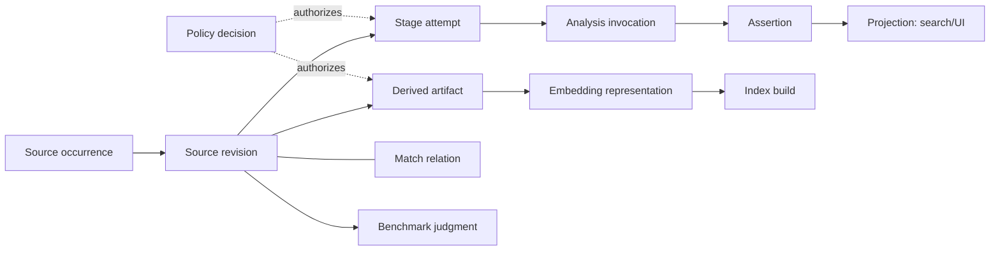

# Astra Canonical Contracts

These are conceptual schemas and invariants. They intentionally omit storage,
SQL, API, and implementation details.

## 1. Identity and provenance graph



| Record | Minimum identity/provenance | Invariant |
| --- | --- | --- |
| Source occurrence | opaque ID, locator observation, custody/context | A path or remote ID locates a source; it is never content identity. |
| Source revision | opaque ID, occurrence ID, bytes/digest evidence, probe evidence | Immutable statement about a specifically read revision. Same bytes may occur in more than one custody context. |
| Content identity | digest algorithm, full digest, byte count | Establishes byte equality only; never ownership, consent, lineage, or preferred source. |
| Derived artifact | ID, digest/type, parents, producer attempt, retention/availability | Derivatives never replace the source. Expired bytes leave an authorized tombstone/digest. |
| Stage attempt | ID, idempotency key, immutable inputs/config, outcomes/errors | Retries are new attempts. The current state is a rebuildable projection. |
| Invocation | ID, parent attempt, capability/model/config, raw response reference | Provider protocol result cannot define stage or assertion truth. |
| Assertion | ID, predicate/value, subject revision/interval, evidence envelope | One assertion makes one claim. Corrections supersede rather than overwrite. |
| Match relation | ID, two revision/interval subjects, method/run/uncertainty | A relation has review/policy records outside itself. |
| Representation/index | representation ID and space ID; index build membership/config | Vectors/indexes are rebuildable projections, never source identity. |
| Judgment/benchmark | query, revision/interval, reviewer/rubric, corpus/label version | Metrics are projections derived from immutable judgments. |
| Policy decision | exact subjects/actions, authority, validity, retention, revocation links | Effective permission is recomputed at use time. |

Every derived claim must resolve through its revision, input artifact, producer
attempt, and applicable policy. A UI, provider, VDF, point, filename, or group
identifier may appear as a locator/reference but cannot replace an opaque record
ID.

## 2. Assertion evidence envelope

```text
assertion_id
subject = source_revision_id | typed_interval_id | derived_artifact_id
predicate + value + value_type
evidence_class + modality
producer = human | deterministic_tool | model | comparison_method
producer_run_or_reviewer_ref
input_artifact_refs + input_coverage
uncertainty = known value | unknown
assertion_status + supersedes/superseded_by
review_refs + retention/replay_availability
```

| Class | Meaning | It does not grant |
| --- | --- | --- |
| `MEASURED` | Deterministic measurement/calculation against named bytes/stream with derivation. | Proof of a semantic action or editorial suitability. |
| `MATCHED` | A comparison/similarity relation with method, inputs, score, and uncertainty. | Canonicality, deletion, exclusion, or a cut. |
| `VISUALLY_OBSERVED` | Content claim grounded in identified frames/video observed by a model or person. | Exhaustive coverage, deterministic timing, or correctness beyond stated coverage. |
| `AUDIO_OBSERVED` | ASR, acoustic, or human-listening claim grounded in identified audio/channel/coverage. | Visual grounding, deterministic transcript truth, or edit timing. |
| `EDITORIAL_INFERENCE` | Preference, recommendation, rubric score, or interpretation linked to inputs. | Factual, technical, policy, or export permission. |

`NOT_OBSERVED` describes missing availability, not a class. A null field has no
assertion class. A review decision may accept an assertion for a named use but
does not promote its class. Conflicting assertions coexist and a projection
states its selection policy.

## 3. Namespaced status model

| Namespace | Values | Legal consequence |
| --- | --- | --- |
| `stage_status` | `PLANNED`, `RUNNING`, `SUCCEEDED`, `PARTIAL`, `FAILED`, `CANCELLED`, `BLOCKED` | A terminal attempt records execution only. `PARTIAL` retains coverage gaps. |
| `provider_status` | `SUCCESS`, `PARTIAL`, `FAILED`, `UNSUPPORTED`, `ESCALATED` | Describes one invocation. It cannot imply stage success, assertion truth, or benchmark validity. |
| `assertion_status` | `ACTIVE`, `UNCERTAIN`, `NOT_OBSERVED`, `SUPERSEDED` | Controls assertion visibility according to an explicit projection rule. |
| `review_status` | `UNREVIEWED`, `ACCEPTED`, `REJECTED`, `AMBIGUOUS` | A review applies to a named relation/assertion/use. |
| `benchmark_status` | `PLANNED`, `VALID`, `INVALID_PROTOCOL`, `PASS`, `FAIL`, `NOT_RUN` | `PASS` exists only after validity and named metric rule. |
| `edit_qc_status` | `DRAFT`, `REFINED`, `REVIEWED`, `RENDERED`, `PASS`, `REVISE`, `BLOCKED` | Gate-3 only; it cannot appear in Gate-0 success. |

A provider `PARTIAL` may leave valid individual assertions but must preserve
missing item coverage. An assertion is searchable only if its policy and
projection rule allow it; it does not become technical evidence merely because
the stage succeeded. An invalid benchmark cannot yield `PASS` or provider
promotion.

## 4. Typed interval envelope

```text
interval_id + source_revision_id + stream_index
time_domain = semantic_seconds | technical_window | matched_offset |
              source_pts | source_frame | proxy_time |
              timeline_time | rendered_output
origin_description + start + end + endpoint_semantics
time_base_or_rate + mapping_artifact_ref
precision + evidence_assertion_refs + producer_attempt_id
refinement_eligibility
```

Intervals are half-open `[start, end)` unless a named external standard requires
another endpoint rule. Technical windows declare the selected stream's
presentation origin. Source PTS/frame claims identify stream/time base; proxy,
timeline, and rendered coordinates require a retained mapping artifact. VFR
media may never derive source frames from `seconds × FPS` alone.

`semantic_seconds`, `technical_window`, `matched_offset`, and
`AUDIO_OBSERVED` timing are candidate/relation evidence. Only a deterministic
source-native attempt that records source stream, PTS/frame mapping, and
measurement derivation can emit `source_pts` or `source_frame` refinement.
Refinement determines technical bounds only; it does not prove that a semantic
event begins or ends there. A human editorial decision is separately required
before a later edit plan consumes a refined range.

## 5. Policy and egress decision

```text
policy_decision_id + authority + decision_time + expires_at
source_revision_ids and source occurrence contexts
sensitivity/consent state + purpose
allowed artifact types + processing boundary/provider family/model
approval reference + retention/deletion rule
egress manifest digest + request/spend/byte limits
decision = ALLOW | DENY | EXPIRED | REVOKED
```

There are two intentionally distinct authorizations. A narrowly scoped
**discovery authorization** may bind an occurrence/locator and custody context
before its bytes are readable; it permits only local read-only discovery,
hashing, and technical probing and cannot permit cloud egress, proxy creation,
embedding, transcription, or long-term derived storage. The resulting revision
may then receive the exact policy decision above. This avoids pretending a
content digest is known before the first authorized read.

Dispatch validates a currently effective `ALLOW` decision before producing a
non-discovery artifact or egressing any governed byte. Any source revision,
occurrence context, purpose, artifact type, provider/model/family, or retention
change requires a new decision. Unknown, expired, or revoked policy denies
dispatch and denies governed cached projection access; it does not erase the
immutable provenance/tombstone. The UI is never the policy boundary. A later
egress event records the decision, exact artifact manifest digest, destination,
result, and retention outcome.

Gate 0 has local-only policy decisions. The contract still applies to derived
frames, vectors, query text, labels, logs, and caches according to their stated
classification; “local” is not a license to retain or expose artifacts without
policy.

## 6. Run, artifact, representation, and rebuildability

A run manifest names exact input revisions, query/gold versions, policy
decisions, profiles/configuration digests, tool/runtime observations, attempts,
and output artifact digests. The logical idempotency key is separate from the
attempt ID and content digests. Failures and omissions are outputs, not absent
rows.

`space_id` identifies compatible query/index encoding: model/weights or known
resolution limit, processor, instructions, preprocessing, pooling,
quantization/runtime behavior, dimension, dtype, normalization, metric, and
config digest. `representation_id` joins a revision, typed window/sampling
manifest, space, generation attempt, and artifact digest. An index build names
the precise set of representations, its algorithm/configuration, and build
digest.

Projections such as current state, search indexes, cache, UI views, and metric
tables are disposable and rebuildable only from retained eligible inputs and
recipes. If policy expires or raw artifacts are deleted, retain the permitted
tombstone/provenance and state that exact rebuildability is unavailable.
