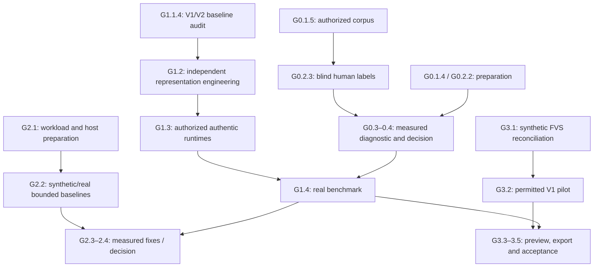

> **2026-10-26 — PR #212 reviewer membership + actual Atlas parallel frontier checkpoint (latest).** Independently verified three-file synthetic-only PR #212 at `83d9df9abee34d6aa22a26f6298f6af9a273956e`, all four GitHub CI workflows green (Python 3.11/3.14), and merged `main@e8ede5ec06d44bebb6139428302b2346a8889336`. Reviewer query IDs are checked against digest-verified prepared queries and technical window IDs against the digest-verified sample manifest; **no human catalog coverage/association or actual human judgment was proven**, G0.2.3 remains unchecked. Parallel execution policy is already mandated by `AGENTS.md` and Remaining-Work Atlas: native fresh Codex roots, rolling BUILD/VERIFY/REPAIR and exclusive writers. Crucial **dated launch-pack drift**: `.orchestration/remaining-work/launch-packs/batch-006/manifest.json` (generated `d6309b247a4336c65484d00c3c5a530aa7c3fe64`) lists `H3-C02` and `H3-E02` as READY while current committed Atlas/progress say both VERIFIED; current `progress.json` identifies `H3-A03` and `H3-B05` READY and `H3-B04` VERIFY_READY (dated 2026-10-21, **not** a live readiness grant). An upcoming Codex controller must run fresh main/contract/lease delta reconciliation before dispatch; **do not replay batch-006 literally, manufacture two extra BUILD roots, claim native threads spawned from a GitHub-only connector, or execute protected/real media/model/provider/production work.** WBS and Atlas have distinct purposes: product scope/checkboxes versus scheduler truth. No Gate promotion or D-3 authorization created.

> **2026-10-26 — G0 D-2 SOURCE-ONLY VALIDATOR, EDITOR LOADER AND REVIEWER BINDING (latest WBS checkpoint).** GitHub-confirmed **#208** merged at `main@408c8c7c4c2f56a22dc447743711122eba69cf0d`, covering `PKT-D2-2` reviewer envelope actual run `config_digest` and reviewer-ID set enforcement. **#209** merged at `main@0c9e0ea2eb9399bda256d6372698dc2bf3c13d77`, covering `PKT-D2-1` isolated, text-only D-2 intake checker and `PKT-D2-3` editor/gold conformance and exact-rational grouping repair; **#211** merged at `main@2f94505ce4b5c776c5144d0122f53d00c3b58cbd` to enforce that unauthenticated `OWNER_SIGNED` declarations **cannot** produce `VERIFIED` D-2 input states, even when their structural checks pass. Independent integrator review caught and corrected `evidence_class` misuse: the intake report now says **`attestation_state`** for `SYNTHETIC_FIXTURE` / `DECLARED_NOT_AUTHENTICATED`, with all five canonical assertion evidence classes unchanged. Each accepted PR head passed all four GitHub workflows, including broad Gate-0 tests for Python 3.11/3.14; the WBS reconciliation PR will separately verify their **combined** merged `main` state. Only these bounded software/test subitems are checked; **real D-2 Owner inputs are NOT_OBSERVED/PENDING, Gate-0 G0.1.4/G0.1.5/G0.2.2/G0.2.3 parents stay [ ], no human review conducted, D-3 remains NOT_AUTHORIZED, real Gate-0 experiment NOT_RUN.** No protected/real archive operation, real model inference/download, provider call or Gate promotion was authorized by these changes.

> **2026-10-25 — D-2 OWNER INPUT / A-7 CROSS-CONTRACT READINESS (latest WBS checkpoint).** GitHub-confirmed documentation-only PR **#205** merged `main@29219281c0bbf948933beb9ef302e85f32dab69f`: thirty-field Gate-0 D-2 intake and validator gap audit `0 VERIFIED / 7 PENDING / 21 BLOCKED / 2 NOT_OBSERVED`; genuine Owner corpus/rights/editors/reviewer/model/host inputs remain absent, and D-3 execution stays `NOT_AUTHORIZED` (code gate literal false). **#206** merged `main@344c500bb7e53afb900ca5ac0b5280fb14d7ccf6`: Gate-3 A-7 `P2` cross-contract decision-ready packet and RED→GREEN task plan **PROPOSED / NON_EXECUTABLE**, no Owner adoption of positional stream mapping or its B-* subordinate decisions. PR-head smoke/Gate-0 D1/Gate-0 broad/Gate-2 CI green for both. Only the **documentation readiness** subitems below are checked. **Gate-0 actual experiment `NOT_RUN`; A-7 positive acceptance `PENDING`, IT-8 `PARKED_BLOCKED`, genuine V2 runtime `NOT_OBSERVED`.** No archive access, model load/download, provider call, real-media editing/export, Gate promotion or Owner-backup changes.

> **2026-10-25 — POST-#202/#203 WBS RECONCILIATION (source/docs only; latest).** PR #202 merged at `main@e755afd724f2c833ec8dbe8c30a8784810681044` with an explicitly **PROVISIONAL / NON_EXECUTABLE** V2 SigLIP2 tokenizer/processor/pooling evidence matrix; documented contradictions between historical `0..31999` and `vocab_size=256000`, and listed missing authentic per-arm token and pooling evidence. PR #203 merged at `main@13e3c96d5be8a22564a52dd34cdaad7085b86291` (corrected accepted head `47623fb547761f17d150fa1165110cfdc5e9f258`), documentation-only A-7 stream-identity proof proposal: `P2` verified positional `tkhd.track_ID` equality with refusal otherwise and independent adversarial RED matrix. All four PR-head GitHub CI workflows passed. **G1.2.3 remains [ ]**, authentic model/rights/runtime still NOT_OBSERVED and Gate B NO_GO_BLOCKED. **A-7 adoption remains [ ] / PENDING**, even though the documentation packet is [x]; positive mapping has not been implemented; IT-8 stays PARKED_BLOCKED. D-2 true corpus and reviewers PENDING, D-3 real execution NOT_AUTHORIZED; no Gate promotion. No authentic model/media read, external provider, production export or destructive action. This checkpoint supersedes only earlier PR-open status prose, not historical evidence.

> **2026-10-25 — GATE-1 G1.1.4 REVIEW-INTEGRATION CHECKPOINT (latest; SOURCE-ONLY).** PR #196 independent evidence/authority review merged at `main@304af7fdbb2b55d29d0d6aba706b1d4714ff552a`; PR #193 after S-1…S-8 + delta review corrections merged at `main@f489a639b658324fd95b4588bbcefec19db3af6e` (accepted head `dc5779d003f84895501423440127fcda503cefab`). The G1.1.4 parent below is now checked for **bounded source-only, preservation-ref, read-only local-asset identity and authority reconciliation**; V1 snapshot `03_V1_BASELINE_SNAPSHOT.md:154` remains **BLOCKED** for exact completion-runtime applicability; historical pilot provenance and authentic V2 model/runtime are **NOT_OBSERVED**. Gate B is `NO_GO_BLOCKED`; Task-4/5 native exception remains `PROPOSED_NOT_ADOPTED`, adopted model-free Amendment 2 and separate T9-SYN Amendment 3 do not grant a current source slice. PR #200 (proposed IT-6 terminal-tail disposition + identifier crosswalk, merged `main@2aab04d9acf3974ff1486e90403e27ac9960f1ee`) changes only documentation; `IT-6 (G-4)` PENDING, `DC-BIND` strict xfail RED, `A-12` consumption re-verification remains distinct. D-2 authentic Gate-0 inputs PENDING and D-3 execution NOT_AUTHORIZED. This WBS change is bookkeeping, not a Gate promotion.

> **2026-10-25 — GATE-3 `IT-6`/`A-12` TERMINAL-TAIL DISPOSITION PACKET (docs-only; latest WBS checkpoint; grants no authority).** `docs/decisions/2026-10-25-g3-g4-terminal-tail-disposition.md` records the decision/alternatives matrix, source-and-test gap inventory, synthetic RED acceptance matrix, rejected alternatives and the verbatim authority request for the terminal-duration/stream-tail question, at base `1cf13a3ff7ad4f9e5af5527fe8d19063a001cec0`. **Identifier crosswalk (`MEASURED`, documentation defect):** canonical `A-12` = consumption-time re-verification of composed evidence (IT-5) + Dv-13 per design §17; the **tail question is `IT-6 (G-4)`** (design `:394`; authority matrix verdict (c) `PENDING`); the third strict xfail is `DC-BIND`; Lane-C owner items are `LC-A-*`. Commit `30a794013` introduced the alias `A-12/IT-6` that reached the owner-approved A′-7 record, this WBS, the handoff, a source comment and tests; the correction is **label-only** and `A-12` is not renumbered. **Measured state:** the third strict xfail and its GREEN pin are simultaneously satisfied at this base (`1 passed, 27 deselected, 1 xfailed`; baseline trio `92 passed, 1 xfailed`); frozen `gate3.refinement.refine()` already implements the tail policy end-to-end (MATCH + `container_path` + end `== duration_ts` ⇒ `end_is_stream_tail=True`, `extent_state=DERIVED_NOT_OBSERVED`, `last_frame_extent=None`; MISMATCH ⇒ `TAIL_NOT_BINDING_ELIGIBLE`); the FVS preview path has **two** independent tail refusals plus one lossy bundle summary, and the verifier never reads the certification it already holds — **the plan pin does carry the full byte-bound certified refinement record**, the verifier simply ignores it; **zero** product consumers read the sealed V2 duration facts. **Disposition proposed (not granted):** `P3` (deferred/unsupported tail) is the interim in-force policy with zero new authority; `P1` (V1 bind refusal, making the xfail GREEN) is **rejected as incompatible** with A′-7 D-1/D-3 and `:46`; the target is `IT-6` bounded acceptance via **pinned-certification acceptance** (`P2m`: digest/verbatim re-check of the already-pinned certified tail record, no new container parse — inside A-12's recorded bound), with **consumption-time re-measurement** (`P2r`, which exceeds A-12's bound and needs an explicit design-R-8 exception plus A-11's derivation subset) deferred and sealed-V2-evidence predicates (`P2e`) only as fallback. The next bounded slice `S1` (verifier-side terminal admission from the pinned certification, one production file + tests) is `BLOCKED_ON_IT6_DISPOSITION`; product reachability additionally needs `S2` (producer interval admission; A-1/Root-G §3.4 placement + A-11, no summary-schema change) and `S3` (`DC-BIND` Owner amendment). Frozen-module hazards (a `tail_end` `duration_consistency`-absent admit hole and the zero-caller `last_delta_ticks` route) are recorded as a durable Problem for `src/gate3/**`, which stays NO DELTA. Supporting evidence lanes: `docs/agent-runs/2026-10-25-g3-a12-tail-duration/`. No behaviour, test, schema, refusal-code, media/model/render or Gate state changed; the strict xfail remains RED.

> **2026-10-25 — G-12 SOURCE/REPORT RECONCILIATION + G0 STAGE-B DESIGN (historical WBS checkpoint).** **Gate-2 PR #197** merged as `main@3b16da198764abde8c1651016ebe94bfea69cd3f` after its exact accepted head `e82dcda08752a0fa999b3e79531ccdc18a18546d` passed **837 Gate-2 tests on both Python 3.11 and 3.14** (GitHub Actions [40207701571](https://github.com/Centaurioun/video-intelligence-pipeline/actions/runs/40207701571)). It corrects the G-12 *narrative* run report, preserves superseded numeric tables as explicit historical evidence, and introduces a digest/receipt-to-report regression test. Original carriers, receipts, and `BUNDLE_MANIFEST.json` remain immutable; synthetic findings are **not** representative archive measurements. Earlier CI collection/dependency failures are retained (resolved by using the existing pinned project CI prerequisites). **Gate-0 PR #198** merged as `main@741f7dee08725fb5d4f1d0a8c55b6ae10a578852` and preserves a **PROPOSED_NON_EXECUTABLE** Stage-B Git-anchor identity portability design + authority audit only: no `macos_stage_b_evidence_anchor.py` implementation authorization, no production code/test mutation, and no Gate promotion. **Gate-1 PR #193 and its independent review PR #196 remain OPEN DRAFT / UNMERGED**; V1 local-asset hash matching cannot certify historical model provenance or completion-runtime applicability, and native Task-4/5 source work remains unapproved while Gate B = `NO_GO_BLOCKED`. G0.1.4 and G2.1.3 parents remain unchecked. Gate-0 D-2 inputs `PENDING`, D-3 real execution `NOT_AUTHORIZED`, valid diagnostic result `NOT_RUN`. Keep the historical checkpoints below for provenance; they may contain superseded status text.

> **2026-10-25 — WAVE-3 GATE-0/GATE-3 INTEGRATION CHECKPOINT (supersedes the prior Wave-2 open-findings status).** Independently inspected and merged **#178** (`main@ee588e0f3768e3827d41400f3563b6d621744b5b`; Gate-0 F2 technical `window_id` foreign-key to `window_sample_manifest.jsonl`, representation revision→source inventory FK, F3 ranked per-declared-arm presence with legitimate failed/pre-ranking status exceptions, and F4 independently executing `--manifest-closure` verifier) plus **#176** (`main@86d281101db1e29506a4692e52b3e937500ba3c1`; strict origin-zero V1 edit-list refusal, no new evidence shape) plus **#177** (`main@43f6faf9333673b9495483e52c9557fe0a93c896`; docs+adversarial tests for A-3 contract choice, IT-2 VFR/PTS-basis divergences and duration consistency). GitHub Python 3.11/3.14 selected synthetic smoke and GitGuardian succeeded at each exact PR head; latest merged main CI [run 40177429062](https://github.com/Centaurioun/video-intelligence-pipeline/actions/runs/40177429062) passed. The independent executor reported Gate-0 **806 local tests passed**, exact generated-MP4 13/13 artifact schemas, `foreign_keys=PASS`, `manifest_closure=PASS`, and 17/17 expected negative mutation outcomes. This is not an independent rerun of the entire 806 tests by the GitHub integrator. **Synthetic Gate-0 report remains `NOT_RUN`, exit 20, `NOT_OBSERVED` for an authorized real experiment.** Gate-0 F2/F3/F4 are closed in their expressly bounded scope; open narrow decisions include `DR-F2-c` revision/window schema join, `DR-F2-d` whether FINITE implies decoded sample, `DR-F3-judgments` per-kind judgment minimum, orphan non-ranked representation window identity, and payload-byte rehash versus digest reference. **Gate-3 A-3 remains `PENDING`**: PR #177 proposes **A′** (additive schema-v2 snapshot temporal evidence, six extra measured/derived facts, legacy v1 verification retained, no implied stream mapping) but only A-9 strict-V1 has been implemented; IT-1, IT-2 fix, IT-3…IT-6 and IT-8 remain not completed. Three strict-xfail RED regression tripwires deliberately remain; they are NOT green implemented functionality. IT-8's actual obstacles are FFprobe-global↔ISO-BMFF-track proof (A-7) and missing snapshot in fixture preview, **not** a missing v2 copy of already recorded source SHA/stream/timebase. Review A′ D-1…D-5 including any change to the frozen `duration_ts` token-pin test and ensure the replacement guard actually allows closed evidence key serialization without permitting nominal-FPS arithmetic; the proposed AST illustration is a design sketch, not code authority. **No model/real/protected-media/provider/production-export/Gate-promotion authorization.** Owner-frozen backup remains `backup/OWNER-DO-NOT-MODIFY-main-20261024-17edacbe@17edacbe64983ae284f09a8386377200bf538ec3` and must never be modified. Re-fetch live main; all SHAs in this checkpoint are date-scoped observations.

> **2026-10-25 — GATE-0 D8 MERGED / GENERATED-MEDIA SUBSTRATE VERIFIED (supersedes the earlier OPEN #173 checkpoint below).** Canonical `main@0ff7db71c44db1e702b579a833413fe0fb6afc99` now contains [PR #173](https://github.com/Centaurioun/video-intelligence-pipeline/pull/173) at reviewed head `a9cd5fdc3f817a95d3ebc0b6e3dc1908c664d5e7`; merged-main Python 3.11/3.14 synthetic smoke passed ([run 40172463173](https://github.com/Centaurioun/video-intelligence-pipeline/actions/runs/40172463173)). Wave-2 generated-fixture video FFprobe/PTS and no-follow/quota/digest protections plus D1–D9 closed-payload schemas are integrated. **D8 representation identity closure:** closed optional `run_manifest.arms` metadata_floor/embedding kinds; metadata rankings have no synthetic `representation_id`; embedding references are mandatory/window-matched and now checked with non-tautological cross-artifact foreign keys, while non-FINITE failed-vector status rows retain provenance. The independent agent's final-run evidence reports **779 Gate-0 tests PASS, 13/13 actual generated-media artifact schema PASS, foreign_keys PASS, manifest closure PASS**; we independently inspected the committed code/reports and GitHub candidate checks, but did **not** independently rerun the entire 779-test local suite on that developer host. **Synthetic `report` still exits 20 / `benchmark_status=NOT_RUN` / `experiment_result=NOT_OBSERVED`**: there is no licensed/authentic model or Owner-authorized real archive/corpus result and no Gate-0 acceptance/promotion. **Open scoped nonblocking development findings:** F2 missing window-ID foreign-key to `window_sample_manifest.jsonl`, F3 registry minimum-per-kind assertion, F4 stand-alone `--manifest-closure` silent no-op and payload-schema dispatcher boundaries, plus the separately recorded D2/D3 typed-interval/relation record-shape materialization and any real-evidence prerequisites. These items are **not silently completed** by 13/13 schema validation; schedule only when their true product dependency is READY. The previous checkpoint line saying #173 is OPEN, Q1 incomplete and the guard tautological is HISTORICAL/SUPERSEDED. The freeze notice remains absolute: `backup/OWNER-DO-NOT-MODIFY-main-20261024-17edacbe@17edacbe64983ae284f09a8386377200bf538ec3`. New agents must re-fetch live GitHub before acting.

> **2026-10-25 — CURRENT WAVE-2 GATE 0 / GATE 3 INTEGRATION CHECKPOINT (newer than the Wave-1 status below).** Verified canonical `main@793e5bd13ce650f427843f576343aed340019ab5` after merge of **#170** (Gate-3 IT-0 FFprobe 9.x frame/packet payload normalization), **#171** (A-1…A-12/IT authority matrix), **#165** (Gate-3 C′ design + generated fixture measurements; **Owner approved only C′/strict origin-zero V1 direction**, not every detailed schema/contract A-item), **#167** (implementation plan), **#168** (Gate-0 D1–D8 remediation plan), and **#172** (Gate-3 IT-7 presentation-tick multiplicity/admission repair). The latest `main` Python 3.11/3.14 synthetic CI succeeded (run 40168139108). **Gate-3 IT-8 remains PARKED** because canonical evidence producers do not yet provide non-vacuous source/stream/timescale provenance; A-3/IT-1 or an explicitly dispositioned A-11 derivation is required. IT-1…IT-6 composition, tail, pilot, production and real-media claims are **NOT_OBSERVED / PENDING** as applicable. **Gate-0 PR #173** is the single combined main-targeted code candidate for #166 and the D1–D9 follow-up: it has independently reported locally measured generated-media PTS, no-follow/quota checks, full local 750-pass suite and actual `--schema-payloads` 13/13, **but is OPEN and NOT merged** because Owner Q1 option A's **closed arm/representation-kind registry and cross-artifact representation identity are not implemented**, D8 §9.2 contract-field placement is unresolved, and a fresh main-targeted two-version CI is not recorded. The existing validator contains a tautological `if rep.get("representation_id") in ranked_ids or reps` guard and metadata ranking synthesizes an unregistered per-window `representation_id`; **syntactic 13/13 is not semantic referential closure**. Exact blocking review: [PR #173](https://github.com/Centaurioun/video-intelligence-pipeline/pull/173), comment 6394265505. Older **#166 was closed unmerged as fully ancestral/superseded**; it is not a completed Gate-0 experiment and its partial head had a historical A05 .gitignore seal test failure. No real/protected archive, authentic model, production export or Gate promotion has been authorized; synthetic `NOT_RUN` remains. **Do not touch** `backup/OWNER-DO-NOT-MODIFY-main-20261024-17edacbe@17edacbe64983ae284f09a8386377200bf538ec3` (Owner notice #149). Before further work, refresh live main and relevant PRs; this paragraph is a dated handoff, not permanent mutable truth. **Next READY work:** focused Gate-0 D8 metadata representation/foreign-key design+TDD on PR #173, Gate-3 IT-8 dependency resolution via A-3/IT-1 or explicitly accepted provenance derivation; leave #169 reference-pack Dependabot unrelated to the Gate product frontier.

> **2026-10-25 — LATEST WBS TRACKING RECONCILIATION (checkpoint only; not new Gate authority).** The current product-completion checklist below remains the **canonical four-Gate execution tracker**. The linked original `planning/four-gate-product-completion-20261025` branch preserves its historical design snapshot; **track ongoing work in this file on canonical `main`**, verifying source/commit/test evidence before setting a checkmark. The preceding Wave-3 checkpoint is historical and predates later merges. **Gate-3 source-only safety:** #181 approved A′-7 design, #183 refusal-only multi-trak FFprobe/ISO namespace safety (not positive mapping acceptance), and #184 additive snapshot temporal-evidence V2 with presentation-PTS VFR basis / two IT-2 regression fixes merged; remaining A-5 names, A-7 acceptance, A-12 terminal-duration policy, full composition and IT-8 remain **PENDING / PARKED_BLOCKED**. **Gate-0 Owner D-1** source-only preparation was independently integrated in **#187 (P-09), #188 (P-05), #189 (P-08)**; #190 updates the separate current-state handoff. All six new D-1 test files plus four existing contract suites ran at #189 candidate commit `8d8031d8a9a85900beb3b5d1a0e16c60769c019b`, GitHub Actions [40194078291](https://github.com/Centaurioun/video-intelligence-pipeline/actions/runs/40194078291), **320 passed per Python 3.11/3.14**. This is **targeted integration evidence**, not full Gate-0 suite acceptance. An attempted broad Linux `tests/gate0` run [40193765335](https://github.com/Centaurioun/video-intelligence-pipeline/actions/runs/40193765335) **FAILED** on both Python versions (13 failed / 842 passed / 64 skipped / 168 errors); probable runner/platform dependencies include absent `ffprobe`, missing historical Git fixture object and macOS Stage-B evidence anchor problems; matched pristine-main Linux baseline remains `NOT_OBSERVED`. **D-2** corpus rights, authentic source identities, 40 editor queries and two human reviewers, licensed model assets/host are `PENDING`; **D-3** real source/model execution is `NOT_AUTHORIZED`; actual Gate-0 `NOT_RUN`. These D-1 P-08/P-05/P-09 identifiers are **packet task IDs, not WBS G0.x IDs**; the bounded crosswalk and checkmarks appear in the relevant WBS nodes below. This status update does not check any real-data task or authorize Gate promotion. Owner backup remains frozen.

> **2026-10-25 — G0.1.4 BROAD-CI REPAIR / G2.1.3 WORKLOAD RECONCILIATION (latest).** Independently reviewed and merged **#194** (`main@83753c0a0c145eaede3d07ae0452f4f769d4439c`); selected broad Gate-0 synthetic suite verified **1,024 passed / 64 platform skips** on each Python 3.11 and 3.14 at candidate `6bb2f1660fedb35c8014d0d264d13f52a787d8f7`, [run 40201413236](https://github.com/Centaurioun/video-intelligence-pipeline/actions/runs/40201413236), with targeted D-1 320 per interpreter. Original Linux broad CI failure [40193765335](https://github.com/Centaurioun/video-intelligence-pipeline/actions/runs/40193765335) remains historical evidence; #194 repairs CI/test fixtures, **not** real experiment execution. **#192** (`main@f7c1759cb71f72ee85541f9a6c01bb6d83c9bb1e`) supplies proposed W0–W10 Gate-2 workload profiles and owner-input template; real archive characteristics remain `NOT_OBSERVED`. Its independent audit also identifies a pre-existing **Gate-2 narrative report versus digest-bound carrier mismatch (G-12)** — do not quote stale report numbers; source receipts remain immutable. **#193** is OPEN DRAFT / DO NOT MERGE; Gate-1 authentic V2 runtime/Task-4/5 authorization remains blocked. **D-2** genuine corpus/model/human inputs `PENDING`; **D-3** real execution `NOT_AUTHORIZED`; Gate promotion `NOT_OBSERVED`. Scoped WBS checkmarks below do not widen these boundaries.

# Video Intelligence Pipeline — Four-Gate Product Completion Work Tree (WBS)

## 2026-10-26 — H3-C05/H3-A04 CONTRACT-ONLY OWNER ADOPTION (supporting checklist, NOT product completion)

Two explicit Repository Owner decisions (2026-10-26) authorize only versioned governing Core/contract documents, related Atlas/prompt references and synthetic contract tests. PRs **[#222](https://github.com/Centaurioun/video-intelligence-pipeline/pull/222)** (C05 v1.0.2), **[#223](https://github.com/Centaurioun/video-intelligence-pipeline/pull/223)** (A04 Option B v1.0.1) and **[#224](https://github.com/Centaurioun/video-intelligence-pipeline/pull/224)** (single-writer shared references + fail-first synthetic regression) are verified merged at `main@137077f2301879ca282e86b488b3e0a648adf9f9`. The adopted successor Markdown hashes are C05 `2cb46d97623d344504d290e880b3c90c7a608b34fb6f2dbe0b8a4d14b421e466` and A04 `04e13d9659a389d3ee32e8de308aeebb86435c4c4c68da771745c136fcfdc2df`. The original C05 v1.0.1 and A04 v1.0.0 Cores remain byte-identical. PR #224 recorded true cross-reference drift RED (one failed, 1165 passed, 64 skipped before sync) and final dual-Python GitHub broad CI **1166 passed, 64 skipped per version**, with nine PR-head checks successful.

- [x] **H3-C05 contract-only version adoption (supporting WBS evidence):** v1.0.2 read-only existing-generation `query-multi` and manifest occurrence/MATCHED nonbinding contract adopted; immutable Core MD/JSON, Owner decision, metadata digest, Atlas/prompt-index pointers and synthetic regression synchronized. **This does NOT check H3-C05 product implementation or certify either historical dependency candidate.**
- [x] **H3-A04 contract-only version adoption (supporting WBS evidence):** v1.0.1 Option B one `CompletedProcess[bytes]` signer observation + exactly one boundary `N4ABoundaryPrimitive` same-instance flow adopted; immutable Core MD/JSON, Owner decision, metadata digest, Atlas/prompt-index pointers and synthetic regression synchronized. **This does NOT check H3-A04 Task-6 implementation or real codesign evidence.**
- [ ] **Post-adoption implementation readiness and acceptance:** run fresh controller ancestry/lease/grant/contract checks on the current main; keep `H3-C05` and `H3-A04` **PLANNED**, no candidate generation or launch overlay; allow any product code/test changes only under a separately scoped authorization. Gate-0 real experiment **NOT_RUN**, D-3 **NOT_AUTHORIZED**, genuine model/runtime and real-media editing **NOT_OBSERVED**, Gate promotion **NOT_GRANTED**. Existing Four-Gate product parents/checkboxes elsewhere in this tree remain unchanged.

**Date:** 2026-10-25 (Europe/Istanbul)  
**Decision:** **OWNER-APPROVED DESIGN** — owner approved the revised English Gate 0–3 work-breakdown tree and its adaptive rolling-frontier parallel execution approach.  
**Status of implementation:** This file is the approved **product-completion design and tracking tree**, not evidence that unchecked work was executed or authorized. Follow scoped executable task plans/packets before product writes.  
**Verified design baseline:** canonical `main@a39d7447a364b3ceac13a5cc6d466b185235b9af`. Refresh GitHub HEAD and applicable contracts before execution.  
**Owner-frozen pre-integration main backup (DO NOT TOUCH):** `backup/OWNER-DO-NOT-MODIFY-main-20261024-17edacbe@17edacbe64983ae284f09a8386377200bf538ec3` ([notice #149](https://github.com/Centaurioun/video-intelligence-pipeline/issues/149)). Do not commit/merge/rebase/reset/rename/delete/move it without a new express Owner decision. This warning is not a new authorization/ruleset mechanism.

## 2026-10-25 — Four Parallel Gate Execution Checkpoint (source-verified, scoped)

Four independently developed candidates were code-reviewed at the source/diff level, had successful GitHub Python 3.11/3.14 synthetic smoke and security checks on their exact heads, and were merged sequentially into canonical main: Gate 1 **#160** (`226cd3efa3fba35011d68553914fcb26316fd460`), Gate 2 **#161** (`eb4603a0ad9a0409055b4f969d4a00704ecc0b42`), Gate 0 **#163** (`f4fe83fdedccd211d23398a7987fec52b193900a`), and Gate 3 **#162** (`ab8a0ab3947ddf815e227724c0fa38c4775d5c07`). A successful constituent-PR CI check is *not* the same as the entire project's full-suite, real-media or Gate-completion certification. Verify live main afresh before acting.

- **Gate 0:** synthetic ten-stage experiment implementation and exact-rational identity/metric repairs are merged. Synthetic experiment result remains `NOT_RUN` / `SYNTHETIC_FIXTURE_NOT_AUTHORIZED_CORPUS`, **not a Gate-0 PASS**. Real corpus, real decoder/model, editor queries and labels remain unchecked.
- **Gate 1:** fail-closed committed geometry/read integrity and a guarded fake-injected native-session **source boundary** merged. Source-only G1.2.1 and G1.2.2 are now checked below. No authentic SigLIP2 loader/tokenizer/MPS inference or comparative benchmark has been verified.
- **Gate 2:** measured and repeatable synthetic local workload with journal restart recovered; `BR-1` decision is valid **only for the frozen synthetic run** and adds no general queue/cache/ANN mandate. G2.1.4 local-synthetic environment and G2.2.1 checkmarked below; real archive scale remains not observed.
- **Gate 3:** synthetic FVS, generated-MP4 nonproduction fixture preview/QC and scope/refusal guards merged. The G3.1.5/G3.1.6 synthetic work and one G3.2.1 pilot-design subitem are checkmarked below; genuine human editorial observation, source-native dual-authority composition, production export and source pilot are not.

**Next product frontier:** G0 synthetic-container ffprobe/decoder integration and experiment schema consistency; G1 authentic adapter source/CLI work only after existing ADR-0002/Gate-B decisions; G2 owner-scoped representative real V1 workload after authorization; G3 dual-timeline authority design, pilot corpus-separation checks, and audio/stream-tail policy. No new development SOURCE-AUTH system, no changes to the Owner-frozen backup.

## 1. Mission and authority

Complete the project's four existing Gates and the minimum integrated product capability required to retrieve useful visual moments from the performing-arts archive, convert semantic candidates into **measured source-native PTS/timebase evidence**, capture human editorial decisions, and produce attributable edit plans, renders and technical/editorial QC. Finish genuine product functionality before unrelated micro-optimizations, historical PR cleanup, UI additions or speculative scale machinery.

This WBS refines scheduling only. It does **not** silently amend the frozen `docs/architecture/GATE_0_EXPERIMENT_CONTRACT.md`, ADR-0002, approved Gate-local specifications, or higher-authority project policy. Gate-0 diagnostic evidence is narrower than frame accuracy, editing suitability, or human time savings. A Gate-1 real benchmark follows an accepted validity-bearing Gate-0 result and new frozen held-out evidence; real rendering/editing and model download/runtime are never authorized by checkbox readiness alone. A separate existing V1 real-media pilot is possible without making it part of Gate-0 diagnostic retrieval.

### Status and scheduling notation

- `[x]` = implementation or scoped existing artifact verified on main at the checkpoint. **Not** a claim of live, production, real-archive or Gate-acceptance proof.
- `[ ]` = deliverable not yet demonstrated as complete. Its work may be proposed, pending, blocked, or already partially implemented.
- **P** = parallel eligible *after* any named predecessors, shared-contract freeze, exclusive writer ownership, and resources.
- **S** = serial within a task family, even when its Gate root runs concurrently with other roots.
- **D** = hard predecessor; name the exact required evidence.
- **A** = fresh explicit authorization for the specified model, media, provider, host, Gate or production action.
- **C** = conditional work only if measured evidence justifies the mechanism.
- **READY** means dependencies, design/implementation authorization, owner, environment and resource constraints are all satisfied; not merely that a task has no arrows.

No task promotes its own evidence class. Allowed assertion classes: `MEASURED`, `MATCHED`, `VISUALLY_OBSERVED`, `AUDIO_OBSERVED`, `EDITORIAL_INFERENCE`. `NOT_OBSERVED` is a state marker only.

## 2. Six-Cycle Iterative Refinement Record

1. **Product scope:** separated local-first implemented foundation from actual real-workload product acceptance; retained the existing four Gate topology; rejected additional management/testing Gate.
2. **Repository evidence:** confirmed scope of merged Gate-0 S8 (#125), Gate-1 synthetic-only adapter (#141), Gate-2 synthetic convergence (#137/#142), Gate-3 Source Snapshot and temporal single-read (#146/#148). Existing code does not imply authorized real-media execution.
3. **Dependencies:** delayed Gate-1 real comparisons until valid Gate-0 evidence; allowed bounded Gate-3 V1 pilot independent of Gate-1 final model choice, and Gate-2 V1 measurements before selected-model verification.
4. **Parallelism:** split independently reviewable tasks by output and file/contract ownership, not by number of checkboxes. Four Gate roots are an *organization*, not a fixed concurrency cap; rolling frontier refills READY work.
5. **Failure/safety:** preserved immutable source revisions, no-follow/digest proofs, fail-closed temporal ambiguity, human editorial control, and separate approvals for real protected/archive work, provider/model operations, production export and Gate promotion.
6. **Execution simulation:** first launch G0.1.4/G0.2.2, G1.1.4, G2.1.3/G2.1.4, G3.1.5/G3.2.1; unblock downstream tasks from verified outputs, not optimistic handoffs.

**Architectural alternatives:** (A) one fully serial Gate thread wastes independent capacity; (B) one thread per leaf manufactures coordination and shared-file conflicts; **(C) four Gate roots with adaptive, exclusive-writer child lanes and one controlled integration path — SELECTED**. Do not manufacture agent tasks to fill slots.

## 3. Gate 0 — Diagnostic Visual Retrieval

**Outcome:** determine whether one locally executed, sampled visual retrieval arm improves top-ten useful-candidate discovery over the transparent metadata baseline. **Do not treat Gate 0 as native-video recognition, frame-accuracy, editorial QC or production interface evaluation.**

### G0.1 — Experiment and Corpus Readiness
- [x] **G0.1.1** — Deterministic inventory, source identity and provenance foundations exist.
- [x] **G0.1.2** — Metadata and semantic retrieval-arm foundations exist.
- [x] **G0.1.3** — S8 evidence-extraction implementation merged via PR #125; R-11/R-12 limitations remain explicit.
- [ ] **G0.1.4 — Current experiment readiness reconciliation [P]**
  - [ ] Match executable code/configuration to current Gate-0 contract without altering its thresholds or evaluation protocol.
  - [ ] Inventory only actual missing behavior, incomplete macOS Stage-B prerequisites and source-use blockers.
  - [x] Record exact symbol/test/host-evidence status and `NOT_OBSERVED` separately **for the broad-CI failure audit only**: #194 R1–R4 root-cause matrix, matched Linux baseline, host tools/Git identity/history, nondeterministic fixture case and unproven exception propagation; NOT a real-source or model-runtime host attestation.
  - [x] **Generated-fixture Wave-2 substrate and D8 semantic identity (synthetic scope only):** local FFprobe presentation-PTS, bounded no-follow media evidence, 13/13 schema closure and metadata-versus-embedding arm foreign keys merged via PR #173; real corpus, labels, licensed weights and Gate-0 experiment remain unchecked.
  - [x] **Wave-3 F2/F3/F4 integrity (synthetic scope only):** required ranked/judged technical window foreign keys, ranked-arm minimum and stand-alone fail-closed manifest closure integrated in PR #178; no authorized real-corpus/Gate PASS, remaining DR decisions still pending.
  - [x] **D-1 P-08 preparation-only software [G0.1.4 partial]:** PR #189 implemented `authorized-corpus.json` declaration/lexical provenance checks and closed `authorized_local` admission; `authorized_local_execution_gate_open() = False`, CLI exit 20 and no declared source access. Integrated at `main@3bccc4ee235110133735a6c5633b1cc2c9cdbe61`, six-file cross-lane GitHub CI 320 PASS on each Python 3.11/3.14. **Not an authorized real corpus, frozen source manifest or full G0.1.4 closure**; historical broad Linux CI failure remains recorded with #194's later repair evidence.
  - [x] **G0.1.4 broad synthetic CI regression infrastructure only:** #194 main@83753c0a0c145eaede3d07ae0452f4f769d4439c, candidate 6bb2f1660fedb35c8014d0d264d13f52a787d8f7; run 40201413236 on both Python 3.11 and 3.14 = 1,024 passed, 64 platform skips, zero fail/error. Existing frozen contract and production code unchanged; full G0.1.4 and actual authorized experiment remain [ ].
  - [x] **PKT-D2-1 bounded text-only D-2 intake checker (G0.1.4 partial):** PR #209 merged at `main@0c9e0ea2eb9399bda256d6372698dc2bf3c13d77` after an integrator evidence-vocabulary correction. `src/gate0/d2_intake.py` + `scripts/verify_gate0_d2_inputs.py` deterministically classify 30 Owner-declared fields and verify package-local JSON/digest references; the new report `attestation_state` is **NOT** one of the five canonical assertion `evidence_class` values. The 30-field synthetic result remains 0 real VERIFIED / 7 PENDING / 21 BLOCKED / 2 NOT_OBSERVED; the original #209 allowed 7 untrusted `OWNER_SIGNED` rows to appear `VERIFIED` (historical defect), but **#211 repaired this fail-closed**: no trusted external attestation exists, so both synthetic and merely declared packages remain **0 VERIFIED / 7 PENDING / 21 BLOCKED / 2 NOT_OBSERVED**; `authenticity=DECLARED_NOT_AUTHENTICATED`, `owner_approval_claimed=false`, and `execution_authorized=false`. No source/media path or actual Owner grant is verified. D-3 literal gate still `False`; no real experiment executed.
  - [x] **PKT-D2-1 Owner-attestation fail-closed correction (source-only):** PR #211 at `main@2f94505ce4b5c776c5144d0122f53d00c3b58cbd` prevents a self-declared `OWNER_SIGNED` field from becoming genuine `VERIFIED` without external trusted proof. Per-row deterministic `VALID` can still be recorded with `DECLARED_EVIDENCE_NOT_AUTHENTICATED`, but its state is `PENDING`. Original #209 synthetic-declared receipts are retained as **historical, superseded behavior**; D-3 remains closed.
  - [x] **Gate-0 D-2 Owner-input readiness crosscheck and intake documentation (G0.1.4 partial):** PR #205 merged at `main@29219281c0bbf948933beb9ef302e85f32dab69f`; `docs/gate0/D2_OWNER_INPUT_READINESS_2026-10-25.md` and `docs/gate0/D2_OWNER_INPUT_INTAKE_CHECKLIST_2026-10-25.md` independently enumerate 30 required inputs: **0 VERIFIED, 7 PENDING, 21 BLOCKED, 2 NOT_OBSERVED** (reported as of this audit, not permanent counts). Schema mismatch: frozen config cannot express some declared model/host fields; closed runtime D-3 gate is hard `False`. The D-2 document is a *readiness report*, **NOT real corpus authorization**. R-01…R-18 remain a contract-owner decision queue; G0.1.4/G0.1.5/G0.2.2 and D-3 remain open.
  - [x] **G0.1.4 Stage-B Git-anchor portability design and authority audit only:** PR #198 (`main@741f7dee08725fb5d4f1d0a8c55b6ae10a578852`) records observed latent host-identity and commit-encoding dependence, preferred fixed non-personal-identity alternative and independent N3/N4B failure-code disposition. Proposed design is **NOT** production implementation authority; source patch, contract-owner ruling and real Stage-B execution remain PENDING.
- [ ] **G0.1.5 — Authorized evaluation corpus [A]**
  - [ ] Identify 60–120 minutes, >=3 sessions, >=6 revisions, with visual-family coverage recorded.
  - [ ] Bind source occurrence/revision/hash/stream/probe/policy identities; preserve immutable media.
  - [ ] Freeze nonleaking development/evaluation partition and source grouping; development subset 10–15 minutes only if used.
  - [ ] Produce a valid, frozen source manifest, or `BLOCKED_PREREQUISITE` without inventing media evidence.

### G0.2 — Queries and Human Labels
- [x] **G0.2.1** — Query families, grade-0/1/2 rubric and evaluation metrics are specified in the Gate-0 contract.
- [ ] **G0.2.2 — Query preparation [P]**
  - [ ] Freeze 24 positive queries (six each: appearance, visible action, interaction, scene/composition/camera movement).
  - [ ] Freeze eight plausible absent queries plus eight separate development queries; preserve editor wording.
  - [ ] Freeze query IDs, version and blinded procedure before seeing held-out rankings.
  - [x] **PKT-D2-3 synthetic editor/gold loader conformance and interval-grouping correction (G0.2.2 partial):** PR #209 merged `main@0c9e0ea2eb9399bda256d6372698dc2bf3c13d77`; new source-only conformance tests cover 24+8+8 cardinality, families, malformed events and reviewer isolation. `labels.build_gold_events` now compares canonical rational interval identity (mapping and pair representations) rather than `tuple(mapping)` keys. Gold-event `evidence_class` continues to enforce the project’s **five canonical assertion classes**; the D-2 intake report `attestation_state` is separate. Genuine editor authorship and real human gold labels remain `NOT_OBSERVED`.
  - [x] **D-1 P-08 editor-query / gold *input seam* [G0.2.2 partial]:** PR #189 added typed preparation loaders, cardinality and split checks, and gold-to-ranker isolation in synthetic tests; **does not create, review or freeze genuine 24+8+8 editor-authored questions or real label versions.**
- [ ] **G0.2.3 — Blind ground-truth review [D: G0.1.5]**
  - [ ] Two independent people inspect the full evaluation corpus and grade revision/interval-linked events.
  - [ ] Adjudicate disagreements, capture interval uncertainty, freeze catalog/labels.
  - [ ] Audit blinded top-ten union; newly discovered positives or wrong absent labels invalidate that held-out version.
  - [x] **PKT-D2 reviewer query/window identity membership (G0.2.3 partial):** PR #212 accepted at `main@e8ede5ec06d44bebb6139428302b2346a8889336` (candidate `83d9df9abee34d6aa22a26f6298f6af9a273956e`); `load_reviewer_input` and evaluate now reject unknown query IDs against digest-verified prepared queries and unknown window IDs against digest-verified `window_sample_manifest.jsonl`, retaining configured reviewer IDs and blinding/config digest binding. GitHub PR-head Gate-0 broad/D1 and smoke/Gate-2 matrix PASS on Python 3.11/3.14; **membership only**: no query↔window pairing/complete human catalog/independence authentication or adjudication proof. Parent G0.2.3 [ ]; D-3 NOT_AUTHORIZED; Gate-0 NOT_RUN.
  - [x] **PKT-D2-2 reviewer-input config and declared-identity binding (G0.2.3 partial):** PR #208 merged at `main@408c8c7c4c2f56a22dc447743711122eba69cf0d`; prepare/evaluate now tie the mapping digest to the **actual canonical run `config_digest`**, reject manifest/config divergence, and enforce the declared reviewer-ID set. Existing input digest algorithm, frozen envelope schema and D-3 closure remain intact. The 17 new focused tests and broad Python 3.11/3.14 CI passed at PR head `8a688200dd95a6eca84221167be58c3b9472e16b`; true reviewer identity authentication/adjudication provenance remain `PENDING`.
  - [x] **D-1 P-05 blinded-envelope software only [G0.2.3 partial]:** PR #188 added `gate0.reviewer_envelope` with synthetic two-reviewer/group/final-adjudication/blinding and boundary regressions. **No human review was performed;** genuine query↔window↔assertion mapping and adjudication provenance policy remain `PENDING`.

### G0.3 — Controlled Diagnostic Execution
- [ ] **G0.3.1 — Configuration freeze [D: G0.1.4, G0.1.5, G0.2.2; A for authentic model]**
  - [ ] Freeze the specified 4 s nonoverlapping half-open technical windows and target-sample rules, declaring the chosen 2 FPS profile.
  - [ ] Bind exact model/weights/processor/runtime/space/tie config and legitimate source policy; no FPS-to-frame derivation.
  - [ ] Demonstrate label isolation before ranking.
  - [x] **D-1 P-09 configuration-freeze *readiness inspector* [G0.3.1 partial]:** PR #187 added `gate0.config_freeze.inspect_freeze_readiness`; validates canonical config digest, caller-supplied observed digest shape and pending/mismatched identities, always `NOT_FROZEN` / `NOT_GRANTED` / `NOT_RUN`; no authentic observation or actual config freeze. Synthetic label isolation seam from P-08 is independently covered at PR #189, not a genuine ranking demonstration.
- [ ] **G0.3.2 — Metadata baseline [D: G0.3.1, labels frozen; A]**
  - [ ] Run the defined basename/parent-directory token-set Jaccard floor, logging empty/all-zero ties.
  - [ ] Produce attributable rankings, gaps and exact artifact identities.
- [ ] **G0.3.3 — Semantic visual arm [D: G0.3.1, labels frozen; A]**
  - [ ] Decode and sample authorized sources at first presentation frame at/after each target; deduplicate, record measured PTS/timebase.
  - [ ] Build/query the declared local vector space and record source-linked ranking, errors and coverage.
  - [ ] Do not promote semantic window timestamps into exact edit endpoints.
- [ ] **G0.3.4 — Repeatability [D: G0.3.2, G0.3.3]**
  - [ ] Rebuild twice from frozen source/config; compare identities, coverage, primary hits, rank/tie order.
  - [ ] Record cold and randomized warm query latency, source minutes, index size, memory and operating limits.

### G0.4 — Validity and Decision
- [ ] **G0.4.1** — Compute grade-2 macro Hit@10 over 24 positive queries, paired lift, per-family results and all failures. [D]
- [ ] **G0.4.2** — Report Hit@1/5, MRR@10, graded nDCG, Precision@10 and absent queries *separately*. [D]
- [ ] **G0.4.3** — Apply preregistered provisional thresholds (Hit@10 >=20/24, lift >=5/24, every family >=3/6), reproducibility, safety and local operability. [D]
- [ ] **G0.4.4** — Record attributable `PASS`/`FAIL`/`INVALID_PROTOCOL` with no claims of editorial time saving, frame accuracy or production fitness. [D]
- [ ] **G0.4.5** — Obtain required Gate-0 acceptance/promotion decision separately from experiment execution. [D + A]

**Internal scheduling:** G0.1.4 and G0.2.2 are simultaneously eligible; G0.1.5 may advance via permitted **selection/planning**, not unauthorized source reads. Labels follow corpus freeze. Frozen metadata/semantic arms can run separately with independent resources; results join only in G0.4.

## 4. Gate 1 — Representation and Capability Selection

**Outcome:** preserve runnable V1 SigLIP Base, prepare independent SigLIP2 Base and SO400M candidates, then compare them under a project-specific frozen benchmark. `synthetic` compatibility never establishes an authentic model winner.

### G1.1 — Representation and V1 Baseline
- [x] **G1.1.1** — Three closed model-free profile identities exist.
- [x] **G1.1.2** — Three-arm synthetic protocol compatibility harness exists; it is **NOT** a real benchmark.
- [x] **G1.1.3** — Frozen V1 preservation anchor recorded in the existing migration plan.
- [x] **G1.1.4 — Baseline, design and task reconciliation [P]** — **SOURCE-ONLY / PROVENANCE-IDENTITY reconciliation complete**, not model runtime or Gate-1 acceptance. Evidence: PR #193 merge `f489a639b658324fd95b4588bbcefec19db3af6e` (report `docs/agent-runs/2026-10-25-g1-1-4-representation-baseline-reconciliation/README.md`), independently reviewed in PR #196 merge `304af7fdbb2b55d29d0d6aba706b1d4714ff552a`; baseline `eaa90f3b984bae84f97f0cb229521378b24b7717`.
  - [x] Verify current V1 source behavior and synthetic regression baseline. Evidence: PR #160 merge `226cd3efa3fba35011d68553914fcb26316fd460` left frozen V1 files / FVS CLI unchanged; `experiments/persistent_local_index/tests/test_model_profile.py`, `tests/gate1/`, `tests/vip_fvs/`; separately reported and independently reviewed at base/main: **310 passed + 10 skips**, **211 passed**, **1217 passed + 1 xfail**. No fresh authentic inference.
  - [x] Verify V1 preservation ref/ancestry: `preservation/vip-v1-post-v2-design-20261009@3586eeaa904fc5a2e6a2745078611886f482f3de` (tree `a7fbe1b0dd1aa6c1dbcc14fda77e16b9958e7d0c`); see `docs/INDEX.md` and PR #196.
  - [x] Verify bounded **local model-asset identity and historical runtime receipt inventory**, not authentic session applicability: seven local SHA-256 identities were re-hashed by the independent #196 reviewer at its host; historical pilot and off-main receipts remain explicitly non-canonical. **`docs/migrations/siglip2-post-completion/03_V1_BASELINE_SNAPSHOT.md:154` remains `BLOCKED`; historical pilot chain-of-custody, completion-runtime reconstruction, licence/tokenizer runtime behavior are `NOT_OBSERVED`.**
  - [x] Distinguish implemented model-free profiles from incomplete V2 runtime or benchmark functions. Evidence: PR #160 merge `226cd3efa3fba35011d68553914fcb26316fd460`, #193 reconciliation `docs/agent-runs/2026-10-25-g1-1-4-representation-baseline-reconciliation/README.md` at merge `f489a639b658324fd95b4588bbcefec19db3af6e`; genuine V2 runtime remains `NOT_OBSERVED`.
  - [x] Check ADR-0002 / Gate-B readiness, migration-plan authority and actual source/test symbols. Evidence: PR #160 merge `226cd3efa3fba35011d68553914fcb26316fd460`, independent #196 decision matrix merge `304af7fdbb2b55d29d0d6aba706b1d4714ff552a`; Gate B `NO_GO_BLOCKED`; native Task-4/5 exception `PROPOSED_NOT_ADOPTED`, separate T9-SYN/Amendment 3 not a grant.
  - [x] Assign exclusive ownership for shared representation, index and FVS interfaces before writers start. Evidence: Gate-1 PR #160 and `GATE3_CLI_HANDOFF.md`; no shared CLI edits.

### G1.2 — Model-Free Engineering and Native Source Implementation
- [x] **G1.2.1 — Storage geometry [D: G1.1.4; conditional code]** — SOURCE/MODEL-FREE ONLY; existing width-aware behavior preserved and committed-count read integrity repaired in PR #160.
  - [x] Verify or complete profile-derived 768/1152-dimensional float32 vector writes, generation isolation and SQLite recovery. Evidence: `require_committed_geometry()` and source-only test suites in PR #160.
  - [x] Preserve V1 semantics; no redundant implementation if already correct. V1 frozen anchor preserved; unchanged V1 default and source-only regressions reported in PR #160.
- [x] **G1.2.2 — Query geometry [P after contract; conditional code]** — SOURCE/MODEL-FREE ONLY; fail-closed query-open committed geometry in PR #160.
  - [x] Verify or complete model-width-aware query vectors, synthetic seams, tie order and cross-space refusal. Evidence: existing query code and PR #160 negative tests.
- [ ] **G1.2.3 — Native V2 model adapters [D: shared contract; A for authentic operations]**
  - [ ] Complete Base and SO400M adapter source under their own implementation authorization.
  - [ ] Specify authentic tokenizer/processor/pooling, model identity, precision, device and failure semantics. **PARTIAL source-only seam**: `experiments/persistent_local_index/siglip2_native.py` requirements are inert; historical 32k warning vs recorded 256k-vocabulary evidence does not establish authentic per-arm BOS/EOS/padding/pooling; see #193 / #196. No authentic model session authorized.
  - [x] **G1.2.3 provisional non-executable tokenizer contract documentation only:** PR #202 merged at `main@e755afd724f2c833ec8dbe8c30a8784810681044`; `docs/migrations/siglip2-post-completion/32_PROVISIONAL_SIGLIP2_TOKENIZER_PROCESSOR_POOLING_CONTRACT.md` records 32k vs 256k contradictory source claims, Base/SO400M unknown tokenizer family, BOS/EOS/padding/attention-mask/pooling/processor/asset identity and future fail-closed prerequisites. No authentic tokenizer or model asset examined, no runtime/loader adopted, no Gate B change; parent G1.2.3 and authentic-specification subitem remain `[ ]`.
  - [x] No model acquisition, native model load or provider call from a source-only task. Evidence: PR #160 injected non-authentic session source boundary, `authentic=True` refusal, no default loader.
- [ ] **G1.2.4 — Product-facing runtime seam [D: applicable G1.2 outputs]**
  - [ ] Bind profile selection into existing FVS/CLI/index/retrieval path with unchanged default V1 behavior. **PARTIAL synthetic-only**: fake profile selection exists (`src/vip_fvs/cli.py`); actual V2 product runtime and a 1152-D product-path regression remain absent per #193. Shared CLI changes still require exclusive ownership and an exact grant.
  - [ ] Preserve source-use policy check before authentic runtime open and isolate all vector spaces. Cross-space refusal is covered synthetically, but `test_rejected_source_does_not_open_v2_model` is **only a planned name**, not an executed test; authentic V2 source-before-open ordering `NOT_OBSERVED` (#193/196).

### G1.3 — Authentic Model Acceptance
- [ ] **G1.3.1 — Exact checkpoint, dependency and host readiness [A]**
  - [ ] Verify local model/processor/revision/weights and genuine CPU/MPS environment.
  - [ ] Document license, precision and fallback policy; do not guess provenance.
- [ ] **G1.3.2 — Bounded native evidence [D: G1.2, G1.3.1; A]**
  - [ ] Execute real Base embeddings; verify output shape, finite values and stable runtime identity.
  - [ ] Execute SO400M embeddings under separately scoped approval; verify 1152-D and precision claims.
  - [ ] Record memory/latency and exact failures without upgrading `NOT_OBSERVED`.

### G1.4 — Real Three-Arm Benchmark and Model Decision
- [ ] **G1.4.1 — Valid benchmark entry [D: G0.4 valid result + G1.3; A]**
  - [ ] Freeze fresh representative, source-disjoint corpus, label/rubric versions and B16/B17 provenance.
  - [ ] Freeze identical query/sample/evaluation conditions; keep three model spaces isolated.
- [ ] **G1.4.2 — Actual comparison [D; A]**
  - [ ] Evaluate V1 SigLIP Base.
  - [ ] Evaluate V2 SigLIP2 Base.
  - [ ] Evaluate V2 SigLIP2 SO400M.
  - [ ] Compare relevance, coverage, memory, latency, reproducibility and operational costs.
- [ ] **G1.4.3 — Representation decision [D]**
  - [ ] Publish valid comparison evidence and winning/sufficient-model decision, including a legitimate V1 fallback.
  - [ ] Freeze selected model/space and an index rebuilding/migration strategy. Do not full-archive index beforehand.
  - [ ] Obtain Gate-1 acceptance decision without equating public benchmark popularity with project success.

**Internal scheduling:** G1.1.4 can overlap Gate-0, Gate-2 and Gate-3 preparatory work. Only disjoint index/query tasks may run simultaneously *after* shared geometry is frozen. Real benchmark depends on Gate-0 validity and authorized native-model evidence.

## 5. Gate 2 — Reliability and Scale

**Outcome:** measure realistic indexing/search/restart workloads, then introduce *only proven necessary* reliability and scale mechanisms.

### G2.1 — Workload and Observation Preparation
- [x] **G2.1.1** — Existing synthetic workload/fault/recovery substrate.
- [x] **G2.1.2** — Gate-2 synthetic evidence-to-mechanism decision logic.
- [ ] **G2.1.3 — Representative workload profile [P]** — PARTIAL proposed W0–W10 synthetic-scope profile and observation template (#192); real archive usage, measured performance and accepted limits remain NOT_OBSERVED.
  - [ ] Capture expected archive counts, lengths, codec variety, storage, concurrency and operator usage.
  - [ ] Specify indexing, query, interruption, resume, repeatability, cache and failure workloads.
  - [ ] Freeze accepted metrics and workload identity without inventing representative production statistics.
  - [x] **G2.1.3 synthetic-scope workload specification and Owner-input template only:** #192, merged main@f7c1759cb71f72ee85541f9a6c01bb6d83c9bb1e, specifies profiles/metric units/reproducibility/unknowns; report-to-receipt numeric mismatch G-12 is explicitly PENDING for independent correction. This checkbox is NOT representative-real-workload acceptance.
- [x] **G2.1.4 — Measurement environment [P]** — LOCAL SYNTHETIC environment only; representative real archive/model host observation remains `NOT_OBSERVED`.
  - [x] Identify host/hardware/storage/OS, expected CPU/MPS leases and isolated measurement tools. Evidence: PR #161 Apple M5 Pro/macOS/APFS/CPython 3.14.9, HEAVY_CPU scope; no authentic MPS workload inferred.
  - [x] Distinguish synthetic evidence from authentic source/model/runtime observations. Evidence: PR #161 separate frozen fixture and observed metrics carriers with explicit `NOT_OBSERVED`.

  - [x] **Gate-2 G-12 narrative-to-receipt discrepancy corrected (synthetic evidence only):** PR #197 (`main@3b16da198764abde8c1651016ebe94bfea69cd3f`) adds an explicitly attributed erratum, preserves superseded values, checks 28/28 immutable manifest entries and derived metrics, and passes 837 Gate-2 tests on each Python 3.11/3.14 (run 40207701571). The original digest-bound carriers are unchanged; G2.1.3 real profile, G-01/G-02 and Gate-2 acceptance remain OPEN.

### G2.2 — Reproducible Baseline Workloads
- [x] **G2.2.1 — Synthetic baseline [D: G2.1]** — bounded synthetic scale-v2 workload executed twice on the development host; evidence in merged PR #161, not representative archive-scale proof.
  - [x] Execute representative bounded generated workloads and interruptions. Evidence: frozen 6×4×65536-byte jobs, three repetitions, interrupt/restart journal in PR #161.
  - [x] Record latency, throughput, space growth, restart identity and integrity. Evidence: two independently recorded receipt bundles at source candidate SHA `4453430a9be0edd21d89ccaa389bd662f48219f6` in PR #161.
- [ ] **G2.2.2 — Bounded real V1 workload [D: G2.1 + accepted exact source/runtime/host; A]**
  - [ ] Run authorized source inventory/index/query without mutating source bytes.
  - [ ] Measure cold/warm resource use and interrupted recovery; preserve complete attempts and failures.
- [ ] **G2.2.3 — Selected-model workload [D: G1.4 + G2.2.2; A]**
  - [ ] Re-measure relevant workloads with the chosen model and actual vector geometry.

### G2.3 — Conditional Reliability/Scale Implementation
- [ ] **G2.3.1 — Failure attribution [D: G2.2]**
  - [ ] Distinguish measured bottlenecks, repeatable failures, data-quality problems and `NOT_OBSERVED`.
- [ ] **G2.3.2 — Justified fixes only [C]**
  - [ ] Cache/batching only if a measured bottleneck warrants it.
  - [ ] Durable checkpoints/recovery/queueing only if measured interruptions or throughput require them.
  - [ ] ANN/vector service only if measured local exact search is genuinely insufficient.
  - [ ] Re-run frozen workloads after each change; preserve correctness and source/representation identities.

### G2.4 — Reliability Acceptance
- [ ] **G2.4.1** — Establish repeatable accepted indexing/search behavior at the declared workload. [D]
- [ ] **G2.4.2** — Demonstrate data integrity, restart/recovery and negative-path behavior. [D]
- [ ] **G2.4.3** — Evaluate agreed latency, memory, storage and throughput limits. [D]
- [ ] **G2.4.4** — Publish attributable workload and mechanism-decision evidence. [D]
- [ ] **G2.4.5** — Obtain Gate-2 reliability/scale acceptance separately from synthetic maturity. [D + A]

**Internal scheduling:** workload definition and environment review can proceed together. V1 workload measurements may start before the final Gate-1 model choice *if* separately authorized. Mechanism changes must follow measured need.

## 6. Gate 3 — Editing, Rendering and QC

**Outcome:** convert semantic candidates into measured and human-approved edit decisions, exact source-native temporal ranges, attributable plans, authorized previews/exports and technical/editorial QC.

### G3.1 — Existing Product Chain and Contract Integration
- [x] **G3.1.1** — Source Snapshot, no-follow and digest-bound source identity.
- [x] **G3.1.2** — Source-native PTS/timebase refinement; never nominal FPS multiplication.
- [x] **G3.1.3** — Human decision and versioned edit-plan software foundations.
- [x] **G3.1.4** — Non-production preview, receipt and technical QC foundations.
- [x] **G3.1.5 — Current end-to-end software reconciliation [P]**
  - [x] Trace candidate → source revision → actual measured interval → human decision → versioned plan → preview/QC receipt.
  - [x] Verify a single supported *synthetic* product entrypoint and list real missing end-to-end behavior.
  - [x] Reconcile CFR/VFR, audio/no-audio, refusal and existing ownership without adding redundant test work.
  - Evidence: `docs/agent-runs/2026-10-25-four-gate-first-wave/gate3-synthetic-execution.md` §1–§5, §7
    (baseline `main@fe2e5352a`, executed synthetic `run` slice CFR + VFR with persisted receipts;
    H1-confirmed missing preview/QC entrypoint recorded as §4.2).
- [x] **G3.1.6 — Repair only demonstrated integration breaks [D: G3.1.5; C]**
  - [x] Preserve exact streams/PTS/timebase, source immutability, typed evidence, valid versioning and fail-closed ambiguity.
  - Evidence: commits `57aba44f5` (descriptor/identity/mode refusals) and `23fa35597` + `34829bd6c`
    plus the `PLAN_SCOPE_MISMATCH` scope guard (non-production `preview-fixture` entrypoint, §6);
    suite `1072 passed`. Only demonstrated breaks repaired; no production/export claim.

  - [x] **Wave-3 A-9 strict V1 only (historical):** measured nonzero edit-list `media_time` refused by temporal binding in PR #176; PR #177 preserved the original A-3 decision/IT-2 RED record, superseded in the *bounded source-only* part by #181/#184 (not by full composition acceptance).
  - [x] **A-7(c) refusal-only namespace protection (synthetic):** PR #183 refuses explicitly selected ISO-BMFF all-trak ordinal on multi-trak inputs when FFprobe-global stream identity is unproven; single-trak and sole-video derivations retained. **A-7 positive FFprobe-to-trak mapping decision remains PENDING and IT-8 remains PARKED_BLOCKED.**
  - [x] **A-7 positive-mapping alternatives and synthetic RED packet prepared (docs-only):** PR #203 merged at `main@13e3c96d5be8a22564a52dd34cdaad7085b86291`; `docs/decisions/2026-10-25-g3-a7-stream-namespace-positive-mapping-disposition.md` proposes `P2` verified positional `tkhd.track_ID` equality, structural/uniqueness guards, hard refusal for unproven matches and owner decision rows `B-1..B-10`. Two independent adversarial reviews; selected synthetic probe 7 accepts / 7 refuses. This checkbox closes documentation, **not** acceptance or implementation.
  - [x] **A-7 P2 cross-contract implementation-readiness plan (docs-only):** PR #206 merged at `main@344c500bb7e53afb900ca5ac0b5280fb14d7ccf6`. `docs/decisions/2026-10-25-g3-a7-cross-contract-integration-readiness.md` and `docs/superpowers/plans/2026-10-25-g3-a7-stream-identity-mapping-implementation-plan.md` specify **proposed** byte/probe digest binding, positional `tkhd.track_ID` checks, `PRODUCER_SEALED` provenance, non-serialized re-derivation, and isolated S1–S5 task ownership. **B-1/B-2/B-3/B-5/B-7/B-9/B-10/B-11 and A-1/A-12 dispositions are not adopted**; no mapping is implemented, and IT-8 stays `PARKED_BLOCKED`.
  - [ ] **A-7 positive-mapping adoption (PENDING; documentation packet prepared):** `docs/decisions/2026-10-25-g3-a7-stream-namespace-positive-mapping-disposition.md` (base `7b72e2b3`) supplies the decision matrix (`P0`–`P5`), the source-level identity trace, `ID-ACCEPT-POSITIONAL-TRACK-ID` + 15 refused predicates, `R-01..R-24` RED matrix, a six-slice implementation packet (`S0`–`S5`) and an explicit authority split (`PA-*` covered, `B-1..B-10` requested). Reviewed by two independent adversarial lanes (both `SHIP_WITH_FIXES`, both upholding `P2`); their blockers are applied, including a live container-ordinal↔FFprobe-index equality gate at `review_bundle.py:360`, a fabricable `tkhd` header-form proof, and the `A-5`/`A-6` label collision. PR #203 (decision proposal only; consult GitHub for its current merge state). Recommended policy is **`P2` verified positional `tkhd.track_ID` identity** (7 ACCEPT / 7 REFUSE on a 14-case synthetic probe; 1223 passed / 1 xfailed at base). **Adoption is NOT granted:** A-7 stays `PENDING`, IT-8 stays `PARKED_BLOCKED`, `src/gate3/**` is unchanged, and no mapping behaviour is implemented.
  - [x] **A′-7 schema-v2 temporal evidence (synthetic source-only):** PR #181 recorded the approved bounded design and PR #184 merged additive 21-key V2 binding, exact decode-order signed `ctts` offsets, origin-zero refusal, measured duration/tail facts and **sorted-presentation-PTS** VFR basis, with legacy V1 behavior preserved. Two IT-2 strict-xfails were resolved only on V2; **`DC-BIND` V1 duration-mismatch strict xfail remains RED; `IT-6 (G-4)` terminal-tail admission remains PENDING; A-5 refusal namespace, positive stream mapping, full C′ composition and real-media IT-8 remain NOT COMPLETED.** `A-12` denotes consumption-time re-verification (IT-5/Dv-13), **not** stream-tail acceptance. The proposed IT-6 alternatives, RED matrix and exact authority request are in `docs/decisions/2026-10-25-g3-g4-terminal-tail-disposition.md`; no tail admission or contract exception has been adopted.

### G3.2 — Bounded Real V1 Editorial Pilot
- [ ] **G3.2.1 — Pilot specification and corpus separation [P]**
  - [x] Choose bounded local V1 source/scenarios and required reviewer decision artifacts, but do not open media without authorization.
    Evidence: `docs/agent-runs/2026-10-25-four-gate-first-wave/gate3-pilot-input-spec.md` (310 lines,
    authorization envelope, CFR/VFR × audio matrix, refusal tables, reviewer artifact set).
  - [ ] Separate Gate-3 pilot media/judgments from Gate-0 held-out label evidence.
    A digest-set-disjointness convention is proposed in the pilot spec §4 but no registry/code exists.
- [ ] **G3.2.2 — Authorized candidate retrieval [D: pilot acceptance; A]**
  - [ ] Bind each authentic candidate to an immutable and exact source revision.
- [ ] **G3.2.3 — Exact editorial refinement [D: G3.2.2]**
  - [ ] Measure source-native frame presentation PTS/timebase and reject ambiguous intervals.
  - [ ] Capture editor accept/reject/revise and output a provenance-bound versioned edit plan.

### G3.3 — Authorized Non-Production Preview and QC
- [ ] **G3.3.1 — Preview generation [D: accepted G3.2 plan; A]**
  - [ ] Render permitted non-production preview, record FFmpeg/ffprobe identity, stream outputs, source/candidate/plan digests.
- [ ] **G3.3.2 — Editorial and technical inspection [D]**
  - [ ] Check exact boundaries, stream properties, A/V synchronization, visual continuity and audio relevance where observed.
  - [ ] Keep independent visual/audio reviewer evidence separate from automated technical QC.
- [ ] **G3.3.3 — Durable review bundle [D]**
  - [ ] Join source revision, candidate, measurement, human decision, plan, preview, failures and QC to an attributable version.

### G3.4 — Production Export
- [ ] **G3.4.1 — Required export profiles and acceptance contract [D: G3.3]**
  - [ ] Define named deliverable formats, timebase/audio requirements and technical/editoryal refusal conditions.
  - [ ] Distinguish production permission from non-production preview PASS.
- [ ] **G3.4.2 — Explicitly approved export implementation/run [D; A]**
  - [ ] Render approved plans and capture output identity/time/codec/source immutability.
- [ ] **G3.4.3 — Independent QC and revision [D]**
  - [ ] Human/editorial and automated/technical acceptance are independently attributable.
  - [ ] Preserve rejected outputs and deterministic retry/rebuild evidence.

### G3.5 — Gate-3 Product Acceptance
- [ ] **G3.5.1** — Repeat authorized real V1 editorial workflow. [D]
- [ ] **G3.5.2** — Verify integration with Gate-1 selected representation when relevant; avoid artificially blocking V1 pilot. [D: G1.4 for final selected-model claim]
- [ ] **G3.5.3** — Produce independent technical + human editorial evidence. [D]
- [ ] **G3.5.4** — Obtain separate Gate-3 acceptance decision; do not treat non-production preview as production export eligible. [D + A]

**Internal scheduling:** G3.1.5 and G3.2.1 can proceed together. Real pilot, preview and production export remain separately bounded/authorized. Gate-3 V1 pilot does not need to await a Gate-1 final winner.

## 7. Dependency Graph and Rolling-Frontier Scheduling

The diagram highlights critical paths, not all mandatory predecessors; exact step dependencies are in each task above. E.g. Gate-3 preliminary preview is not blocked by Gate-1 benchmark, whereas final selected-model claim is.

### First READY/preparatory wave — four Gate roots, adaptive children

| Root | Initial independent packet(s) | Next unlock | Required scope |
|---|---|---|---|
| `VIP-G0-READINESS` | `G0.1.4`, `G0.2.2` | freeze valid corpus, then labels, then G0.3 | read-only planning; no protected/real media |
| `VIP-G1-BASELINE` | `G1.1.4` and independent runtime/model feasibility inventory | scoped G1.2 work after contract/plan readiness | read-only; no downloads, real runtime or provider |
| `VIP-G2-WORKLOAD` | `G2.1.3`, `G2.1.4` | synthetic G2.2.1 | read-only inputs; synthetic work only if scoped |
| `VIP-G3-INTEGRATION` | `G3.1.5`, `G3.2.1` | repair only proven gaps; separately approved V1 pilot | read-only + existing synthetic verification, no real protected media or export |

Do not turn every checkbox into an agent. Assign each root one accountable coordinator, and independent H4 tasks with exclusive file/contract ownership. Independent READ_ONLY code audits may coexist. Serialized worktree/ref administration, shared contract edits and integration remain single-writer. Gate-0 human labels and Gate-1 benchmark are NOT filler for idle slots.

### Dependency-safe implementation rules

1. Start only tasks proven `READY`; record `BASE_SHA`, exact task ID, inputs, output contract, claimed evidence class, allowed files, and blocked operations.
2. Use trigger-based Superpowers: brainstorming for new behavior/architecture; writing-plans after approved design; TDD for product changes; systematic-debugging before fixes; review and verification for integration.
3. Use the existing `docs/architecture/THROUGHPUT_FIRST_DEVELOPMENT_PROTOCOL.md`, `SUBAGENT_LANE_PROTOCOL.md` and `resource-policy-v5.yaml`. No fixed global agent count; adaptive heavy-resource leases.
4. Record immutable candidate SHAs and owned branches; never merge sibling branches blindly or modify canonical `main` without explicit Owner authorization for the integrated state.
5. Use scoped technical deliverables instead of ceremony-only documents. When a task reveals no missing product functionality, mark it **VERIFIED_NO_CHANGE** with evidence; do not manufacture code.
6. After each completed task, verify independently, update this WBS based on evidence, and immediately refill the dependency-safe frontier.
7. Historical/synthetic claims remain scoped: `M3_SYNTHETIC_READY` is not live scale proof or automatic Gate promotion.

## 8. Initial Launch Packet Index and Acceptance Evidence

- **G0:** current contract/implementation matrix, missing features or `VERIFIED_NO_CHANGE`, local experiment prerequisites, frozen draft query/rubric proposal (not human labels).
- **G1:** current V1 baseline/profiles/storage/query/FVS implementation map, exact readiness/authority barriers in existing migration plan, disjoint next implementation interfaces. No pretend real model success.
- **G2:** representative workload proposal separated into known user facts, assumed estimates and `NOT_OBSERVED`; measurement schema and synthetic-case coverage map.
- **G3:** end-to-end source-to-QC symbol/interface trace, a reproduced synthetic acceptance run if a local environment exists, and explicit pilot scenario with auth-needed operations.

**Checkmark policy:** `[x]` only after verifying the exact outcome on a cited immutable commit with relevant test/report/runtime evidence. No automatic checkmark from PR existence or agent terminal prose.

## 9. Governing References

- `docs/project/00_PROJECT_CHARTER.md`
- `docs/project/01_CURRENT_STATE_AND_HANDOFF.md`
- `docs/project/02_ORCHESTRATION_DESIGN_AND_NEXT_PLAN.md`
- `docs/project/STATE_MAINTENANCE_PROTOCOL.md`
- `AGENTS.md`
- `docs/architecture/GATE_0_EXPERIMENT_CONTRACT.md`
- `docs/architecture/CANONICAL_CONTRACTS.md`
- `docs/decisions/ADR-0002-post-completion-siglip2-migration-and-benchmark.md`
- `docs/decisions/ADR-0003-development-source-authorization-enforcement-removed.md`
- `docs/superpowers/plans/2026-10-09-vip-v2-siglip2-migration-implementation-plan.md`
- `docs/architecture/THROUGHPUT_FIRST_DEVELOPMENT_PROTOCOL.md`
- `docs/architecture/SUBAGENT_LANE_PROTOCOL.md`
- `docs/portfolio/portfolio-v1/resource-policy-v5.yaml`

This WBS is a living, evidence-controlled product-completion tracker. The Owner will consider out-of-scope remaining product ideas only after Gate 0–3 work is substantively complete.
