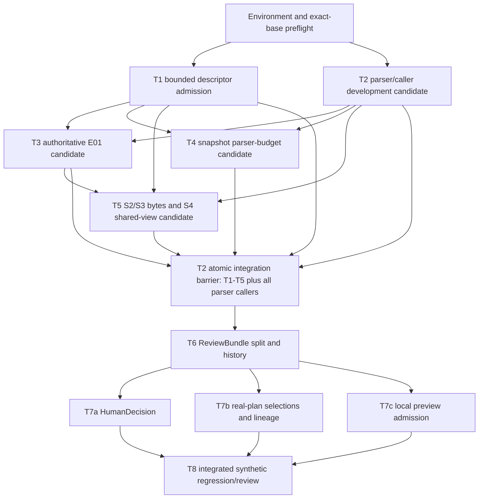

# VIP Gate-3 A-7 S5 Scoped Synthetic TDD Implementation Plan

> **For agentic workers:** This document is a proposed plan only. It grants no source or test write authority. If separately authorized, execute one named slice at a time in its own exact-base worktree; do not interpret this plan as permission to begin implementation.

**Goal:** Add synthetic-only, operation-scoped S5 stream-identity admission using one bounded immutable source byte view shared with authoritative E01 remeasurement, while retaining the adopted A-7 evidence and temporal boundaries.

**Architecture:** A descriptor-based bounded reader admits source and decision-bearing artifact bytes under explicit finite limits and verifies digests on the exact immutable bytes returned. E01 and S5 share that source view in one operation; structural ReviewBundle integrity, external snapshot/E01 revalidation, S5 identity admission, and consumer permission remain separate stages. Limits in this plan are test-only; the production profile remains unavailable until independently justified and adopted.

**Tech Stack:** Python 3.14-compatible standard library, `pytest`, existing Gate-3 ISO-BMFF fixture builders, existing snapshot/refinement/ReviewBundle helpers, GitHub Actions and signed Git commits.

**Spec:** `docs/decisions/2026-10-28-a7-s5-shared-admission-owner-adoption.md` (adopted architecture only); evidence input `PR #255` at `20a2e8a76482ce31ea1648f73bed0eedf5efa7e7`.

**Plan status:** `PROPOSED — PLAN ONLY — NO SOURCE WRITE AUTHORITY`.

**Readiness states:** `PLAN_READY=TRUE_FOR_OWNER_PLAN_REVIEW`: tasks, test-only finite limits, interfaces, dependencies, exact selectors and stop conditions are specified. This does not mean that unresolved implementation decisions are approved. `IMPLEMENTATION_AUTHORIZED=FALSE`. `PRODUCTION_READY=FALSE` and `PRODUCTION_RESOURCE_BUDGET=PENDING_EVIDENCE`.

## Global Constraints

- Input base verified for this plan: canonical `main@bc032924d7129f3a7b96a9db17942d007757b00f`; re-fetch and stop if it changes before any later authorized slice starts.
- Architecture authority: PR #254 adopted D1–D7; A-12/P-11 amendment PR #251 remains in force. The proposal does not extend implementation authority.
- Use the same complete, bounded, SHA-256-verified, genuinely immutable source bytes for E01 source-native timing remeasurement and S5 structural stream-identity inspection within each admission operation.
- `PRODUCTION_RESOURCE_BUDGET=PENDING_EVIDENCE`. No production source, sample, JSON, row, depth, or process-memory maximum is adopted here; no unlimited fallback is allowed.
- Keep public `is_binding_eligible(record) -> bool` authoritative and behaviorally compatible. Any internal admitted-bytes route must share the same authoritative checks; caller timing arrays, structural-only checks, self-declared digests, unresolved artifacts, or substituted locators never grant eligibility.
- The D2 frozen-contract exception is limited to `_parse_stts`, `_parse_ctts`, `parse_iso_bmff_timing_bytes`, and directly necessary budget plumbing. Stop if a change alters unrelated Gate-3 timing behavior or cannot be mapped to the adopted exception.
- Preflight source-wide timing sample counts before any per-sample expansion. Count `ctts` coverage against already-counted `stts` samples without double counting. Accepted PTS/timebase values and public parser result shape remain identical.
- S5 reads only adopted structural identity metadata. It adds no timing-table parse, PTS/timebase calculation, edit boundary, FFmpeg/FFprobe invocation, evidence field, receipt, schema, or sealed-record rewrite.
- `PRODUCER_SEALED` remains a producer assertion; `demuxer_build_state=NOT_OBSERVED` remains unchanged.
- No serialized or reusable S5-success boolean. `current_e01_validated` remains E01-only.
- Historical ReviewBundle V1/V2/V3 bytes, schemas, digests, and receipts stay unchanged. Structurally malformed or digest-tampered records remain rejected; valid records with unavailable external dependencies may load unverified.
- Source identity is proved only for the bytes admitted in the current operation. A later renderer reopening a pathname is a separate, unproved identity boundary.
- Synthetic temporary fixtures only. No authentic/protected media, FFmpeg/FFprobe, providers, models, rendering, export, or Gate promotion.
- This planning Goal ran no tests, installed no dependencies, changed no source/tests, and authorizes neither implementation nor production admission.

## Review Focus

1. **Oversize before allocation/read:** reject based on descriptor metadata before staging or consuming content bytes; every failure returns no buffer.
2. **Growth, truncation, replacement, and mutation:** read at most the admitted initial size; compare descriptor and held-parent-relative path identity after reading; refuse any visible change; do not claim protection from a hostile writer that can mutate and restore metadata.
3. **E01/S5 byte identity:** prove both consumers receive the same immutable `bytes` object and verified digest; separately document any bounded snapshot/artifact reads that remain.
4. **Parser amplification:** reject a source-wide over-budget `stts`/`ctts` expansion before allocating a sample-sized list, while preserving accepted source-native values.
5. **Load versus authority:** V1/V2/V3 structural readability, external E01/snapshot status, fresh S5 admission, and consumer permission must not collapse into one persisted status.

---

## Verified Baseline and Evidence Accounting

### Repository and authority

- **VERIFIED:** canonical GitHub `main` was `bc032924d7129f3a7b96a9db17942d007757b00f` (tree `4dc1021b96079708b0443dfd36f897728c3900f3`) when this plan was prepared. PR #254 is merged and its D1–D7 adoption document is present on that main.
- **VERIFIED:** PR #255 is OPEN/Draft at `20a2e8a76482ce31ea1648f73bed0eedf5efa7e7`, based on `main`; GitHub reports the HEAD signature `verified=true`, `reason=valid`. Its only changed path is `docs/agent-runs/2026-10-28-a7-s5-synthetic-readiness-evidence.md`.
- **VERIFIED:** the PR #255 review keeps `BLOCKED_PENDING_SYNTHETIC_EVIDENCE`, states hosted test jobs had zero steps, and identifies that the latest actual-helper script/result are transient and are not reproduced by the PR appendices. The review’s helper measurements remain agent-reported, not independently rerun by this planning Goal.
- **VERIFIED from current source:** ReviewBundle consumption-time S5 is absent; `refinement_adapter.py` currently does S4 timing parse and stream identity checks through separate path-based reads; source and JSON reads include unbounded `Path.read_bytes()` calls; `_parse_stts` and `_parse_ctts` expand sample entries before a total budget check.
- **MEASURED in PR #255, not repeated here:** prior synthetic parser/probe/descriptor and simplified combined-operation observations. They do not certify production capacity or platform behavior.
- **REPORTED by PR #255 addendum, not independently rerun here:** one 506-byte fixture passed named-byte and persisted-artifact `is_binding_eligible`, V2 and available-dependency V3 loading, and snapshot helpers; V1 with missing E01 loaded with `current_e01_validated=False`; V3 after snapshot removal raised `SNAPSHOT_PATH_OPEN_FAILED`. Reported traced peak was 1,177,175 bytes and wall time 13.54 ms, n=1; RSS was not observed. The associated script and JSON are transient `/tmp` files; their hashes do not make the experiment reproducible from PR contents.
- **NOT_EXECUTED:** this Goal ran no pytest commands. PR #255 hosted Actions had `FAILURE` with zero executed steps; the precise infrastructure cause was not independently established. Do not label those jobs PASS.

### Existing implementation anchors at `bc032924d7129f3a7b96a9db17942d007757b00f`

| Surface | Current anchor and consequence |
|---|---|
| `src/gate3/container.py` | `_resolved_byte_source_path` 33–59; `_parse_stts` 91–95; `_parse_ctts` 96–123; `_trak_timing` 132–139; `parse_iso_bmff_timing_bytes` 155–201; path wrapper with unbounded read 202–204; `verified_measurement_artifact` and source resolver use 205–275. |
| `src/gate3/refinement.py` | `_resolve_byte_authority` 56–90; `_remeasured_facts` 337–375; `_byte_authority_covers` 377–410; authoritative public `is_binding_eligible` 461 onward. Named and persisted derivations can independently reopen the source. |
| `src/vip_fvs/source_snapshot.py` | `_open_regular_nofollow` 300–310 uses `getattr(os, "O_NOFOLLOW", 0)`; `_digest_fd` 313–325; `_read_snapshot_bytes` 328–357 returns a read-only memoryview backed by a mutable bytearray; `capture` 431 onward; `verify` 586 onward; temporal paths parse bytes at 740–752 and 848–860; `verify_snapshot_evidence` 1056–1132. |
| `src/vip_fvs/stream_identity_gate.py` | Source path read 77–92; probe read/digest/JSON parse 133–167; path-based `require_bound_stream_identity` 170–204; pure positional S2 predicate is `gate3.stream_identity.require_stream_identity`. |
| `src/vip_fvs/refinement_adapter.py` | E01 timing path parse at 187; S5 call at 213; authoritative E01 predicate at 280. S4 must retain bind-time refusal while sharing bytes. |
| `src/vip_fvs/review_bundle.py` | V3 external snapshot check occurs inside `_validate_payload` at 144–151; persisted E01 artifact is loaded and passed to `is_binding_eligible` at 322–355; `current_e01_validated` is an E01 flag at 373–426; ReviewBundle file uses unbounded `read_bytes()` at 478–494. No S5 consumer admission exists. |
| `src/vip_fvs/human_decision.py` | Creation requires `current_e01_validated` at 130–138; resume reloads and checks E01 at 283–288. |
| `src/vip_fvs/real_plan.py` | Refinement artifact is reopened at 252–280; single-plan entry at 284; multi-selection entry at 477; lineage helpers at 573–605. |
| `src/vip_fvs/local_preview.py` | Multi-preview reloads each selection at 556–579; native-runner boundary begins later; single render entry at 805 onward. Fresh S5 must precede runner invocation, but does not bind a later renderer pathname reopen to admitted bytes. |

### Existing tests and current synthetic environment

Observed test surfaces:

- `tests/gate3/test_stream_identity_mapping.py`: existing pure S2 cases R01–R22, including audio-first/video-second, positional mismatch, malformed `tkhd`, track-ID duplication, and no-timing-table identity.
- `tests/vip_fvs/test_stream_identity_gate.py`: existing R-G1–R-G8 plus unreadable container/probe and malformed ISO/JSON refusal cases.
- `tests/vip_fvs/test_stream_identity_bind.py`: existing R-B1–R-B4 and bind wrapper forwarding cases.
- `tests/vip_fvs/unit/test_review_bundle.py`: V1/V2 record/digest and artifact identity tests. `tests/vip_fvs/integration/test_review_bundle_persistence.py`: atomic save/readback, tamper/schema rejection, and concurrency tests; fresh-process test uses Python subprocess, not media tools.
- `tests/vip_fvs/unit/test_source_snapshot.py`: capture, digest, symlink, quota and consume revalidation cases; relevant temporal suites include `test_source_snapshot_temporal_single_read.py`, `test_source_snapshot_temporal_v2.py`, `test_source_snapshot_temporal_origin_refusal.py`, and `test_source_snapshot_temporal_refusals.py`.
- `tests/vip_fvs/unit/test_real_source_temporal_authority.py`, `tests/vip_fvs/adversarial/test_temporal_authority.py`, and `tests/vip_fvs/unit/test_refinement_adapter.py`: source-native timebase/PTS and adapter authority regressions.
- `tests/vip_fvs/unit/test_human_decision.py`: decision/resume/pin/lineage behavior.
- `tests/vip_fvs/unit/test_real_plan.py` and `tests/vip_fvs/adversarial/test_real_plan_authority.py`: single/multi-selection, lineage, pins, rebind and refusal behavior.
- `tests/vip_fvs/unit/test_local_preview.py` documents and uses an in-memory runner double. For S5 tests, invoke only new admission selectors that assert the runner is never called. Do not run `tests/vip_fvs/integration/test_local_preview_real_tools_generated.py` or any media/native integration suite.

**Environment observed during plan preparation:** an existing interpreter at `/Users/yusuf/Repos/video-intelligence-pipeline/.venv/bin/python` reports Python 3.14.9, pytest 8.3.3, jsonschema 4.26.0, NumPy 2.5.3; with `PYTHONPATH="$PWD/src:$PWD/experiments"`, `persistent_local_index` is importable from the checked-out `experiments/` package. This environment is outside the isolated plan worktree and must be rechecked read-only before later use. No installation is needed for the currently observed dependency set. If that preflight changes, stop and create a separately authorized ENABLE task; do not turn import/collection failure into behavioral RED.

**Read-only recheck during PR #256 remediation:** the same interpreter still reports Python 3.14.9, pytest 8.3.3 and jsonschema 4.26.0; with the command's `PYTHONPATH` rooted at this PR worktree, `persistent_local_index` imported from this worktree's `experiments/persistent_local_index/__init__.py`. This was an import/version probe only; no tests ran and no packages changed. A first import probe without `PYTHONPATH` failed with `ModuleNotFoundError: persistent_local_index`; using the documented `PYTHONPATH` corrected setup and is not behavioral RED.

### Test selector accounting at current main

Existing selectors inspected on this baseline include `tests/gate3/test_stream_identity_mapping.py::test_r02_audio_first_video_second_proves_selected_video`, `tests/gate3/test_stream_identity_mapping.py::test_r16_swapped_probe_positions_refuse`, `tests/gate3/test_stream_identity_mapping.py::test_r20_valid_track_identity_does_not_require_timing_tables`, `tests/vip_fvs/test_stream_identity_gate.py::test_r_g5_single_track_uses_legacy_success_without_probe_artifact`, `tests/vip_fvs/unit/test_refinement_adapter.py::test_nonuniform_pts_are_used_verbatim_never_nominal_fps`, `tests/vip_fvs/unit/test_source_snapshot_temporal_single_read.py::test_binding_does_not_reread_snapshot_bytes_for_timing_measurement`, `tests/vip_fvs/unit/test_source_snapshot_temporal_single_read.py::test_iso_bmff_timing_measurement_is_unchanged`, `tests/vip_fvs/unit/test_source_snapshot_temporal_single_read.py::test_stts_entry_count_violation_keeps_public_refusal_code`, `tests/vip_fvs/integration/test_review_bundle_persistence.py::test_load_rejects_tampered_record_digest`, `tests/vip_fvs/adversarial/test_real_preview_verifier_qc.py::test_verifier_rederives_source_authority_from_sealed_plan_and_evidence`, `tests/vip_fvs/unit/test_real_preview_qc.py::test_technical_qc_blocks_unbound_expected_duration`, and `tests/vip_fvs/unit/test_coordinator.py::test_missing_stage_fails_closed_and_records_refusal`.

The proposed new test files `tests/vip_fvs/unit/test_bounded_admission.py`, `tests/gate3/test_container_sample_budget.py`, `tests/gate3/test_refinement_admitted_bytes.py`, and `tests/vip_fvs/integration/test_s5_shared_admission.py` do not exist at this baseline. Every test name marked NEW in the Tasks section is a proposed selector, not a current test. Before a future behavioral RED, the test module and any new function/signature seam must be importable and `pytest --collect-only` must succeed. For an existing public API, first add only the minimum authorized importable interface seam if the proposed test needs a new parameter/result. A TypeError/import/dependency/collection failure is setup or API incompleteness, never behavioral RED. Whole-file regression commands are compatibility checks; they do not imply that proposed selectors already exist.

Before T2 authorization, the integration owner must rerun `rg -n 'parse_iso_bmff_timing(_bytes)?\(' src tests` and close every source and test callsite. Do not infer selector existence from a plan command.

### PR #256 review #5690051286 response map

- P1 parser/caller compatibility: **Option B atomic integration boundary**, required finite parser keyword and direct caller/test migration matrix in Task 2; T2 cannot be independently promoted.
- P1 dependency omissions: the dependency graph now contains `T2 -> T4` and `T3 -> T5`; task inputs and atomic integration notes repeat these constraints.
- P2 TDD semantics: importable scaffold plus collection precedes behavioral RED across new interfaces; Task 8 is integrated acceptance and does not require a synthetic failure.
- P1 trusted-root/artifact authority: the admission API now requires held-root capability and component walk from `/`; source/probe digest authority comes from validated parents, and self-declared canonical digests do not grant binding.
- P2 historical V3 classification: Task 6 separates absent/unavailable external evidence from present-but-invalid evidence and preserves record/schema/digest bytes.
- Selector/environment accounting: existing selectors, new proposed test modules, and this remediation's read-only interpreter import/version observation are explicitly distinguished above.

All commands below are proposed future commands, not commands run in this planning Goal. At each future task start, require `git rev-parse HEAD` to equal that task’s recorded base and `git status --porcelain` to be empty. The initial plan base is `bc032924d7129f3a7b96a9db17942d007757b00f`; after a prior slice is integrated, record its exact new base SHA before launching the dependent slice.

| Slice | Required input SHA |
|---|---|
| T0 | Live canonical main, verified again at dispatch; currently `bc032924d7129f3a7b96a9db17942d007757b00f`. |
| T1 and T2 candidate development | The exact clean main SHA recorded by T0; the plan baseline is `bc032924d7129f3a7b96a9db17942d007757b00f`. T1 and T2 may develop independently only after separate exact grants and on disjoint paths. |
| T3 and T4 candidates | Exact T1 and T2 candidate heads; record each SHA at dispatch. These are development inputs, not accepted/promoted integration heads. |
| T5 candidate | Exact T1 and T2 candidate heads plus the exact T3 candidate head; T3 is an unconditional dependency. |
| T2 atomic integration barrier | Exact composite candidate based on the separately accepted T1 head (or including T1 only if explicitly integrated in the same authorized batch), plus T2–T5 required work, all D2 direct-caller plumbing, and the T2-owned callsite-only migration in `tests/vip_fvs/integration/test_local_preview_real_tools_generated.py`. Record the composite SHA; no T2–T5 component head is promoted separately. |
| T6 | Exact accepted T1–T5 composite integration head. |
| T7a/T7b/T7c | Exact accepted T6 head. |
| T8 | Exact accepted T7a–T7c integration head based on accepted T6. |

Never substitute a moving branch name for the recorded SHA. If a dependency has not been integrated or its exact head cannot be bound, leave the dependent task unstarted.

```bash
export VIP_S5_PYTHON=/Users/yusuf/Repos/video-intelligence-pipeline/.venv/bin/python
export PYTHONPATH="$PWD/src:$PWD/experiments"
"$VIP_S5_PYTHON" -c 'import pytest, jsonschema, persistent_local_index; print("S5_TEST_ENV_READY")'
```

If the command cannot import all three modules, stop before tests. Do not install or download anything within this plan’s implementation task; any prerequisite repair must be its own authorized ENABLE task.

## Proposed Internal Interfaces

Names below make the later plan executable in structure. They are proposed internal interfaces, not frozen public API or current implementation authority.

### Shared bounded admission

```python
@dataclass(frozen=True)
class AdmissionLimits:
    source_bytes: int
    timing_samples: int
    probe_json_bytes: int
    refinement_json_bytes: int
    review_bundle_json_bytes: int
    snapshot_manifest_json_bytes: int
    probe_stream_rows: int
    json_depth: int
    read_chunk_bytes: int

@dataclass(frozen=True)
class TrustedRoot:
    directory_fd: int          # held directory capability; caller must close it
    device: int
    inode: int
    root_components: tuple[str, ...]

@dataclass(frozen=True)
class AdmittedFileBytes:
    data: bytes                 # genuinely immutable; no mutable backing alias escapes
    sha256: str
    byte_count: int
    locator: str               # exact original locator; never silently substituted
    device: int
    inode: int

def open_trusted_root(
    absolute_root: str | os.PathLike[str],
) -> TrustedRoot: ...

def admit_relative_file_bytes(
    root: TrustedRoot,
    original_locator: str | os.PathLike[str],
    *,
    max_bytes: int,
    expected_sha256: str | None,
    chunk_bytes: int,
) -> AdmittedFileBytes: ...
```

`open_trusted_root` is a capability boundary, not permission to trust an arbitrary process-wide pathname. The caller must nominate an owner-controlled root; it is opened from `/` by walking every component with directory descriptors and no-follow semantics (`openat`-equivalent, `O_DIRECTORY`, and `O_NOFOLLOW` where provided), verifying each component before trusting the final root, then holding the root descriptor for the whole operation. If the OS cannot enforce that walk, root creation and admission refuse. Windows reparse-point handling is unsupported until separately validated; no POSIX/Windows equivalence is claimed. For this initial synthetic-only design, tests create an isolated temporary root and pass its held capability; production callers have no approved root policy yet. `original_locator` must be an absolute locator beneath that exact root or a normalized relative locator; reject traversal (`..`), empty/dot components, paths outside the root, alternate separators, parent/final symlinks, and non-regular files. Resolve/open each component descriptor-relative; never canonicalize or substitute a locator. Keep descriptors alive through the read and post-read checks, then close them on all paths.

`max_bytes` and `chunk_bytes` are required positive finite arguments. `expected_sha256` for source media and probe artifacts must come from the already validated external binding/record, never from the artifact being admitted. A bounded envelope or manifest may first be read without an expected digest only for structural/canonical integrity checking; its internal digest is not independent identity and cannot grant binding permission. Before any consumer uses it, bind its bytes to the appropriate validated parent record, manifest reference, external expected digest, or governing integrity contract. Missing authority refuses binding. The reader `fstat`s before allocation/read and refuses a non-regular or initially oversized file; allocates at most the admitted size; reads no more than that size in chunks; rejects early EOF; then compares descriptor identity/size/change metadata and the held-parent-relative name identity. Hash the exact staged content, freeze it to immutable `bytes`, verify the expected SHA-256 over those returned bytes, and return no object after any error. No `read_bytes()` fallback is allowed in a binding path. A content writer that mutates and restores every observable metadata field during the read cannot be excluded by portable descriptor checks; SHA-256 binds only the actual returned buffer, not an atomic filesystem snapshot or a later path reopen. Peak staging/frozen-copy memory can approach twice `max_bytes`, plus parser/runtime allocations, so finite production limits remain pending.

The API names above remain proposed internal names. The required contract is the held trusted-root capability, descriptor-relative no-follow admission, finite cap, exact-locator retention, complete immutable buffer and digest verification. If the platform cannot satisfy these conditions, it refuses rather than using ordinary path-based reads.

### E01 internal admitted-byte route

```python
def _is_binding_eligible_with_admitted_source(
    record: Mapping[str, Any],
    admitted_source: AdmittedFileBytes,
    *,
    limits: AdmissionLimits,
) -> bool: ...
```

The public `is_binding_eligible(record) -> bool` remains the authoritative compatibility entry point. Both paths must delegate to the same internal evidence/eligibility checks; the admitted-byte route substitutes only the already verified source-byte view for source reopening. It must preserve named-byte and persisted-measurement-artifact evidence requirements, exact source locator, selected stream, timing enumeration, and digest checks. No caller-supplied PTS array becomes source proof.

### S5 identity and operation-scoped binding

```python
def _require_stream_identity_from_admitted_bytes(
    *,
    source: AdmittedFileBytes,
    probe: AdmittedFileBytes | None,
    selected_stream_index: int,
    limits: AdmissionLimits,
) -> StreamIdentityEvidence: ...

def _admit_review_bundle_binding_operation(
    bundle: ReviewBundle,
    *,
    limits: AdmissionLimits,
) -> OperationBindingAdmission: ...
```

The internal operation result contains only transient, non-serialized source/E01/S5 facts for use in the current call. Consumers must request it afresh and discard it on return; it is not a cache, authorization boolean, receipt, or ReviewBundle field. It must not be stored on a sealed object or reused by another consumer operation. S2 remains the existing pure positional identity predicate. `container_path=None`, missing source bytes, or an unbound/missing multi-track probe refuses.

## Synthetic-Only Resource Profile

The values below are **proposed TDD fixture settings only**. They are not defaults, production maxima, or workload benchmarks. A test passes the complete limits object explicitly; no implicit unlimited value is permitted.

| Test parameter | Finite test-only value | Use |
|---|---:|---|
| Reader unit source cap | 4 KiB | Oversize-before-read, growth and mutation unit cases; sparse file for cap+1. |
| Integrated synthetic source cap | 8 MiB | Upper bound for one synthetic integrated admission; no 256 MiB allocation. |
| Timing sample cap | 20,000 | Boundary acceptance; 20,001 is rejected before sample expansion. Prior 20k observation is reported evidence only, not a new measurement. |
| Probe JSON cap | 1 MiB | Bounded synthetic multi-track probe input. |
| Refinement JSON cap | 1 MiB | Persisted E01 artifact. |
| ReviewBundle JSON cap | 512 KiB | Sealed record input. |
| Snapshot manifest JSON cap | 64 KiB | External manifest parse. |
| Probe rows | 64 | Row boundary and plus-one refusal. |
| JSON nesting depth | 64 | Pre-parse depth guard and malformed/deep nesting cases. |
| Read chunk | 64 KiB | Maximum content read request in the test reader. No N+1 byte probe. |
| Child-process resource guard | 256 MiB RSS ceiling where the host can enforce it; otherwise maximum fixture sizes above and RSS marked NOT_OBSERVED | A test harness guard only, not a process-memory production limit. Do not run a larger configuration if no hard guard can be established. |

The previously reported candidates (source 256 MiB, samples 250,000, probe/refinement 16 MiB each, bundle 8 MiB, rows 4,096, depth 64, process 512 MiB) remain diagnostic candidates only. In particular, a source buffer plus immutable copy can exceed 512 MiB before parser/JSON/runtime allocations; this plan makes no combined-capacity claim. The production profile remains `PENDING_EVIDENCE`; until it is separately adopted, application admission has no production profile and must fail closed when no finite limit object is supplied.

## Dependency Graph



**Workload/resource classes (not duration estimates):** T0 is READ_ONLY/light; T1 is bounded LIGHT_IO with 4 KiB unit and 8 MiB integrated fixture caps; T2 is LIGHT_CPU/MEMORY capped at 20,000 samples; T3–T7 are LIGHT_CPU/IO with bounded synthetic files; T8 is MODERATE synthetic CPU/IO with an 8 MiB maximum source fixture and child resource guard where enforceable. No wall-clock promise or production capacity estimate is made.

T1 and T2 candidate development may proceed separately only after separate exact authorizations. T1 owns only its two new admission paths, has no dependency on T2, and may be accepted independently after its own focused GREEN and review. D2 remains one serialized Gate-3 owner; no two writers may overlap `container.py` or its parser-budget plumbing. T2 is never independently promotable. T3 and T4 require T1/T2 candidates; T5 requires T1/T2/T3 candidates, with T3 mandatory. After those candidates are complete, the single T2 atomic integration barrier verifies the accepted T1 head plus T2–T5 work, every direct parser caller and explicit finite-budget propagation, including the narrowly assigned native-test callsite migration below. Only the complete T2–T5 composite may be accepted before T6 starts. The native preview integration suite remains excluded from all executable commands. T7a/T7b/T7c retain disjoint source/test ownership and start only from accepted T6; T7c has no prerequisite role in T2 promotion. T8 starts after T7a–T7c are integrated and is synthetic acceptance, not a forced RED. No parallelism is required when isolated exact-base lanes cannot be bound.

## Exclusive File Ownership Matrix

| Path | Classification | Exclusive planned owner | Boundary |
|---|---|---|---|
| `src/vip_fvs/bounded_admission.py` | REQUIRED — NEW | T1 | One shared descriptor-relative reader; no parallel alternate reader. New module is justified only because current snapshot helpers are private/snapshot-specific and expose a memoryview backed by mutable storage. If a review proves the existing helper can be safely generalized without duplicating readers or weakening snapshot semantics, stop and revise this ownership before code. |
| `tests/vip_fvs/unit/test_bounded_admission.py` | REQUIRED — NEW | T1 | Synthetic descriptor/path/resource attacks only. |
| `src/gate3/container.py` | FROZEN / D2 CONTRACT-OWNER SCOPE REQUIRED | T2 | Only `_parse_stts`, `_parse_ctts`, `parse_iso_bmff_timing_bytes`, and directly necessary budget plumbing. No unrelated parser/time behavior. |
| `tests/gate3/test_container_sample_budget.py` | REQUIRED — NEW | T2 | Pure synthetic ISO-BMFF sample-count cases plus budget-call propagation assertions for verify/QC/discriminating/prototype surfaces. |
| `tests/gate3/test_fvs_synthetic.py`, `tests/gate3/test_stream_namespace_safety.py` | REQUIRED — DIRECT TEST-CALL MIGRATION | T2 | Add explicit finite test-only parser budget at existing direct calls; preserve current synthetic assertions. |
| `src/gate3/refinement.py` | FROZEN / D3 SHARED SURFACE | T3 | Internal byte-oriented route sharing the authoritative eligibility implementation; public predicate semantics stay authoritative and compatible. |
| `tests/gate3/test_refinement_admitted_bytes.py` | REQUIRED — NEW | T3 | Named/persisted E01 derivation and refusal equivalence. |
| `tests/vip_fvs/unit/test_real_source_temporal_authority.py` | REQUIRED — DIRECT TEST-CALL MIGRATION | T3 | Add explicit finite test-only budget at existing parser calls; preserve E01 and temporal-evidence regression assertions. |
| `src/vip_fvs/source_snapshot.py` | CONDITIONAL / FROZEN-SHARED | T4 | Adapt snapshot evidence/manifest validation to bounded admission and optional same admitted source view. Do not change snapshot identity or sealed evidence fields. |
| `tests/vip_fvs/unit/test_source_snapshot.py`, `tests/vip_fvs/unit/test_source_snapshot_temporal_single_read.py`, `tests/vip_fvs/unit/test_source_snapshot_temporal_v2.py`, `tests/vip_fvs/unit/test_source_snapshot_temporal_origin_refusal.py`, `tests/vip_fvs/adversarial/test_source_snapshot_temporal_safety.py`, `tests/vip_fvs/adversarial/test_temporal_evidence_v1_matrix.py`, `tests/vip_fvs/adversarial/test_temporal_vfr_basis_divergence.py` | REQUIRED — T4-OWNED TEST PATHS | T4 | Add explicit finite test-only parser budget where direct calls exist; add bounded-reader/snapshot assertions only in the named tests. One T4 owner controls these paths. |
| `src/vip_fvs/stream_identity_gate.py` | REQUIRED | T5 | Add/use bytes-oriented internal S2 wrapper; retain public typed refusal/evidence semantics and single-track path. |
| `src/vip_fvs/refinement_adapter.py` | REQUIRED for D1/S4 | T5 | Bind-time E01 and S5 consume the same `AdmittedFileBytes`; no added timing parse. |
| `tests/vip_fvs/test_stream_identity_gate.py` | REQUIRED | T5 | Bytes route, probe budget and refusal regressions. |
| `tests/vip_fvs/test_stream_identity_bind.py` | REQUIRED | T5 | S4 adapter forwards one admitted view to E01 and S5; direct parser test calls receive explicit finite test-only caps. |
| `tests/gate3/test_stream_identity_mapping.py` | FROZEN REGRESSION / READ-ONLY | T5 | Run existing S2 predicate regressions unchanged; modify only under separate S2 authority, which this plan does not request. |
| `src/vip_fvs/review_bundle.py` | REQUIRED | T6 | Separate structural validation, bounded external E01/snapshot status and current consumer operation admission; preserve sealed record bytes/schema/digest. |
| `tests/vip_fvs/unit/test_review_bundle.py` | REQUIRED | T6 | V1/V2/V3 structure, dependency availability and E01-only status. |
| `tests/vip_fvs/integration/test_review_bundle_persistence.py` | REQUIRED | T6 | On-disk bounded read, canonical digest and tamper refusal. |
| `src/vip_fvs/human_decision.py` | REQUIRED | T7a | Fresh S5 at create and resume; no stored flag. |
| `tests/vip_fvs/unit/test_human_decision.py` | REQUIRED | T7a | Decision create/resume success/refusal. |
| `src/vip_fvs/real_plan.py` | REQUIRED | T7b | Fresh admission for single/multi-selection and every lineage selection. |
| `tests/vip_fvs/unit/test_real_plan.py` | REQUIRED | T7b | Synthetic single/multi/lineage behavior. |
| `tests/vip_fvs/adversarial/test_real_plan_authority.py` | REQUIRED | T7b | Pin substitution and fail-closed authority. |
| `src/vip_fvs/local_preview.py` | REQUIRED | T7c | Fresh S5 check before preview runner; no native invocation in S5 tests. |
| `tests/vip_fvs/unit/test_local_preview.py` | REQUIRED | T7c | New tests use a runner spy that fails if called; existing mocked cases only. |
| `tests/vip_fvs/integration/test_s5_shared_admission.py` | REQUIRED — NEW | T8 | Durable reproduction of the current temporary actual-helper experiment and integrated same-buffer/refusal assertions. |
| `src/gate3/verify.py`, `src/gate3/qc.py`, `src/gate3/discriminating.py`, `src/gate3/functional_prototype.py`, `src/vip_fvs/coordinator.py` | REQUIRED FOR ATOMIC T2 — D2 DIRECT-CALLER PLUMBING | One serialized T2 D2 owner | Thread required finite `max_timing_samples` through the named direct caller and its immediate operation boundary. No arbitrary default or unrelated behavior change. Any additional upstream surface discovered by call-graph closure blocks T2 pending exact D2 owner disposition. |
| `tests/vip_fvs/integration/test_local_preview_real_tools_generated.py` | REQUIRED — `T2_ATOMIC_CALLSITE_COMPATIBILITY_ONLY` / NEVER RUN | One serialized T2 D2 owner | Change only the existing parser call to pass explicit finite test-only `max_timing_samples`. No assertions, rendering, subprocess or behavior edits. Exact future T2 grant must name this path; the file is excluded from every test command. |
| `src/vip_fvs/real_preview_receipt.py`, schemas, receipts, sealed historical records, `docs/decisions/*`, WBS, Atlas, source media, FFmpeg/FFprobe tooling | OUT_OF_SCOPE / MUST REMAIN UNCHANGED | None | No serialized S5 state, receipt/schema update, historic rewrite or runtime/native scope. |

## Tasks

### Task 0: Environment, authority, and exact-base preflight

**Files:** Read-only. No repository edits.

**Interfaces:** Verify current `main`, PR #254 adoption and PR #255 report at exact SHAs before any later slice. Recheck the environment command above. Record the exact base SHA, dirty status, tool versions and `persistent_local_index` import path in the future run ledger.

- [ ] Verify `git rev-parse HEAD`, `git status --porcelain`, base ancestry and target branch before each slice. Expected: clean isolated worktree at recorded base; any mismatch stops the lane.
- [ ] Run the environment preflight command. Expected: `S5_TEST_ENV_READY`; otherwise create a separately authorized ENABLE task and stop behavioral tests.
- [ ] Re-fetch PR #254/#255 only for their current facts; do not treat PR #255 as merged or production certification.

**Stop conditions:** Missing dependency/import, changed main/authority, dirty worktree, unavailable finite test profile, or an unexpected implementation contract delta. No package install during the planning Goal.

### Task 1: Bounded descriptor admission

**Files:** Create `src/vip_fvs/bounded_admission.py`; create `tests/vip_fvs/unit/test_bounded_admission.py`.

**Inputs:** The exact base recorded by Task 0; all tests use small temporary synthetic files and an explicitly supplied cap. **Exclusive owner:** one T1 worker for both paths.

**Proposed interface:** `TrustedRoot`, `AdmissionLimits`, `AdmittedFileBytes`, `open_trusted_root(...)`, and `admit_relative_file_bytes(...)` as defined above. The operation accepts only an already validated held-root capability plus a locator contained beneath it. The API traverses every path component using held directory descriptors, refuses missing no-follow capability, verifies regular-file status, rejects `st_size > max_bytes` before allocating or reading, reads at most the admitted initial size in finite chunks, rejects early EOF, compares pre/post descriptor identity/size/change metadata and final held-parent-relative path identity, computes SHA-256 over the exact returned immutable bytes, and returns no buffer on any failure. It must not read `limit+1` bytes. There is no arbitrary absolute-path helper and no symlink-following fallback.

- [ ] Establish test setup first: create the new module and importable `TrustedRoot`/`AdmittedFileBytes`/reader interface skeleton inside T1's exact file grant. A missing module, missing dependency or collection failure is setup failure, never behavioral RED.
- [ ] Add NEW tests with `TEST_CAP=4096`, `TEST_CHUNK=1024`: `test_admits_regular_file_as_immutable_digest_bound_bytes`; `test_oversize_refuses_before_read_or_allocation`; `test_final_and_parent_symlinks_refuse`; `test_absolute_outside_root_and_dotdot_refuse`; `test_trusted_root_refuses_symlink_in_any_ancestor_component`; `test_missing_nofollow_capability_refuses_without_fallback`; `test_fifo_refuses_without_blocking`; `test_growth_refuses_without_reading_beyond_initial_admitted_size`; `test_truncation_refuses_without_partial_result`; `test_path_replacement_refuses_after_descriptor_open`; `test_visible_same_inode_mutation_refuses`; `test_digest_mismatch_returns_no_buffer`; `test_returned_buffer_has_no_mutable_alias`.
- [ ] RED sequence: first run `"$VIP_S5_PYTHON" -m pytest --collect-only -q tests/vip_fvs/unit/test_bounded_admission.py`; expected: collection succeeds after the importable skeleton. Then run `"$VIP_S5_PYTHON" -m pytest tests/vip_fvs/unit/test_bounded_admission.py -q`; expected behavioral assertion failures for missing refusal/admission behavior. Save actual assertion output only if observed. TypeError/import/collection/environment errors are not RED and require setup correction before any behavioral claim.
- [ ] Implement only T1’s reader and typed refusal mapping. Use a bytearray staging buffer capped to the pre-read size, freeze once to `bytes`, drop all mutable aliases before return. A post-read `fstat` plus final component `stat(..., dir_fd=parent_fd, follow_symlinks=False)` is required where supported.
- [ ] GREEN command: same selector. Expected: all named admission tests pass; read instrumentation proves oversize consumes 0 content bytes, every read request is `<= TEST_CHUNK`, total never exceeds cap, and every failure returns no result.
- [ ] Run regression: `"$VIP_S5_PYTHON" -m pytest tests/vip_fvs/unit/test_source_snapshot.py -q`. Expected: existing snapshot capture/digest/symlink/quota tests pass. This is a required compatibility signal; if the helper is not integrated yet, no snapshot semantics may be changed in T1.

**Not proven after T1:** filesystem immutability; an adversary changing content and restoring every observable metadata value; future pathname identity; any production OS support. If root ancestry cannot be walked component-by-component with no-follow semantics on the host, the synthetic admission test refuses and T1 remains blocked; the old temporary-root prototype is not evidence for ancestors above that root.

**Depends on:** Task 0. **Downstream:** T3–T8. **Review/integration:** review exact exception/refusal names and whether the new utility is genuinely necessary before accepting a new module. **Stop:** any unbounded fallback, `limit+1` read, mutable alias, unsupported path downgrade, or no defensible path-root policy.

### Task 2: Frozen parser pre-allocation sample budget

**Files:** `src/gate3/container.py`, the direct source callers in the migration matrix below, their narrowly scoped tests, and the callsite-only compatibility edit in `tests/vip_fvs/integration/test_local_preview_real_tools_generated.py`. T2 is one serialized D2 integration owner; no parallel writer may touch parser code or its caller plumbing. The native test-file edit is owned by T2 only for this one callsite, requires explicit inclusion in the future T2 grant, and must never be executed under this plan.

**Inputs:** exact Task 0 base; D2 exception in PR #254; test-only `timing_samples=20_000`. **Exclusive owner:** one named Gate-3 contract owner for the entire `container.py`/caller inventory and integration.

**Selected strategy: Option B — atomic parser/caller integration boundary.** A required finite keyword-only `max_timing_samples: int` is added to both parser entrypoints; there is no default, `None`, infinity or compatibility fallback. This preserves the parser result shape, but intentionally makes every old callsite fail fast until it supplies a finite budget. Keeping a legacy unbounded path would violate adopted D2 pre-allocation safety; adding an arbitrary default would invent production policy. Therefore the T2 parser commit is a development candidate only and MUST NOT be independently promoted or merged. The atomic integration candidate comprises T2 plus all parser callers and budget propagation owned by T3/T4/T5; it becomes integration-ready only when every caller below is migrated and the complete regression set passes. Feature task sequencing remains T1/T2 -> T3/T4 -> T5 -> T6; it does not turn T2 into a mergeable half-migration.

**Proposed parser API:**

```python
def parse_iso_bmff_timing_bytes(
    raw: bytes | bytearray | memoryview,
    *, selected_stream_index: int | None = None,
    max_timing_samples: int,
) -> dict[str, object]: ...

def parse_iso_bmff_timing(
    path: str | os.PathLike[str],
    *, selected_stream_index: int | None = None,
    max_timing_samples: int,
) -> dict[str, object]: ...
```

Both require an exact positive finite integer. `_parse_stts` first preflights raw run counts with overflow-safe `run_count <= limit - cumulative`; the complete source-wide `stts` total is checked before any per-sample `dts`/PTS/offset output is allocated. `_parse_ctts` then validates version, run-count coverage and equality with the decoded count before expansion; it is coverage of the already-counted samples and is not added to the source total. Any malformed, inconsistent, unsupported or over-budget table fails closed using the existing parser `ValueError` family; over-budget uses the proposed internal reason `ISO_BMFF_TIMING_SAMPLE_BUDGET_EXCEEDED`, which must not become a new public evidence field/code without a separate ruling. Accepted PTS, timebase, result keys and values remain byte-for-byte equivalent to the current parser. A missing/invalid budget is a refusal before table expansion.

Option A is rejected for this baseline: an opt-in bounded internal route would leave existing public/parser callers able to reach pre-budget expansion or would require a legacy unlimited fallback. The D2 contract adopts pre-allocation budgeting, so the parser/caller set must cross the integration boundary together.

The required keyword has no default; an omitted keyword fails immediately with Python's `TypeError` before parsing, while a supplied non-positive, non-integer, boolean, or over-limit value fails with the parser's existing `ValueError` refusal family. The latter reason mapping must be tested without changing public evidence. The path wrapper still has its current `Path.read_bytes()` behavior in the present implementation; sample budgeting alone is **not** a bounded source-read guarantee. S5/E01 binding paths must use T1's bounded admitted bytes and the byte parser. This distinction prevents T2 from being described as solving D1/D5 file admission by itself.

**Caller and staged-integration matrix at current main `bc032924d7129f3a7b96a9db17942d007757b00f`:**

| Current caller / role | Required budget propagation and owner | Refusal contract and existing regression surface | Can remain GREEN before atomic integration? |
|---|---|---|---|
| `container.parse_iso_bmff_timing` -> `parse_iso_bmff_timing_bytes` (`container.py:202–204`); `verified_measurement_artifact(..., require_resolved_bytes=True)` -> path parser (`:263–268`) — public parser and persisted-artifact byte remeasurement | T2 requires the explicit finite argument in both APIs and the internal artifact resolver. | Preserve result mapping and canonical artifact checks; invalid/over-limit still refuses, never shape-only binding. Regression: `tests/vip_fvs/unit/test_real_source_temporal_authority.py::test_binding_reverification_rejects_altered_persisted_measurement_artifact`; parser callsites in existing synthetic tests must pass a test-only cap. | No; omitted argument fails closed, so no independently promotable T2 head. |
| `refinement._resolve_byte_authority` (`refinement.py:56–90`) and `_remeasured_facts` / `_byte_authority_covers` (`:337–410`, called by public `is_binding_eligible`) — authoritative named-byte and persisted E01 paths | T3 passes operation limits into the same authoritative evaluator and admitted-byte route; persisted artifact locator must resolve the source under the same root, with no substitute. | Keep public `is_binding_eligible(record) -> bool`; unmeasurable/over-budget maps to `False`. Regression: `tests/vip_fvs/unit/test_real_source_temporal_authority.py::{test_binding_reverification_rejects_altered_persisted_measurement_artifact,test_vfr_source_pts_keep_measured_timebase_and_ticks}` and `tests/vip_fvs/unit/test_refinement_adapter.py`. | No; T3 callsites need the API. |
| `source_snapshot` temporal byte parsers (`source_snapshot.py:746,854`) — snapshot/E01 temporal verification, not S5 identity | T4 passes the same finite operation budget or separately bounded snapshot budget; same admitted source view only when locator and digest match, otherwise a separately bounded read is counted. | Preserve existing `SourceSnapshotError` and temporal refusal codes/records. Regression selectors: `test_binding_does_not_reread_snapshot_bytes_for_timing_measurement`, `test_binding_materializes_snapshot_bytes_exactly_once`, `test_shared_read_refuses_snapshot_above_its_byte_budget`, `test_iso_bmff_timing_measurement_is_unchanged`, in `tests/vip_fvs/unit/test_source_snapshot_temporal_single_read.py`; plus `tests/vip_fvs/unit/test_source_snapshot_temporal_v2.py`. | No; T4 requires the bounded parser API. |
| `refinement_adapter` S4 timing call (`refinement_adapter.py:187`) — bind-time E01 remeasurement before S4 identity check | T5 threads one finite operation limit through E01; identity receives the same admitted bytes but performs no timing parse. | Preserve bind-time refusal class/prefix and the single-track/no-probe path. Regressions: `tests/vip_fvs/unit/test_refinement_adapter.py::test_nonuniform_pts_are_used_verbatim_never_nominal_fps` and `tests/vip_fvs/test_stream_identity_gate.py::test_r_g5_single_track_uses_legacy_success_without_probe_artifact`. | No; T5 needs T3's byte route and the T2 budget API. |
| `verify._re_derive(refinement, container_path)` (`gate3/verify.py:30–35`), called by `verify_refinement` (`:111`) — verifier re-derives source identity/timing, not an S5 grant | T2 D2 owner changes both boundaries to require keyword-only `max_timing_samples: int`; caller must pass a finite explicit value. | Preserve fail-closed `DISAGREE` / `unmeasurable_subject`. Existing regression: `tests/vip_fvs/adversarial/test_real_preview_verifier_qc.py::test_verifier_rederives_source_authority_from_sealed_plan_and_evidence`; add NEW `test_verifier_over_budget_refuses_as_disagreement` in that file. | No; the parser and verifier path are one atomic candidate. |
| `qc._named_bytes_stream_index(att)` (`gate3/qc.py:5–18`), called from binding-origin QC (`:127`) — named-byte stream remeasurement | T2 D2 owner adds required keyword-only `max_timing_samples` at both helpers and passes it from the QC operation. | Preserve `QC_NAMED_BYTES_UNMEASURABLE` and QC result shape. Existing regressions: `tests/vip_fvs/unit/test_real_preview_qc.py::test_technical_qc_blocks_unbound_expected_duration` and `tests/vip_fvs/adversarial/test_real_preview_verifier_qc.py::test_qc_does_not_promote_verifier_contradiction`; add NEW `test_qc_named_bytes_over_budget_refuses`. | No; QC cannot use an unlimited compatibility call. |
| `discriminating.classify_container(path)` / `_naive_vs_lookup_discriminates(path)` (`gate3/discriminating.py:11–15`), called by report build and verification (`:22,36,45`) — evidence producer/diagnostic | T2 D2 owner adds required `max_timing_samples` to helpers and report build/verify boundaries; all immediate callers pass it. | Preserve report fields and refusal behavior. No `tests/**/discriminating*` module exists on this baseline; add NEW `tests/gate3/test_container_sample_budget.py::test_discriminating_report_threads_finite_sample_budget`. | No; test and report callers must migrate in the atomic candidate. |
| `functional_prototype.measure_source(path)` (`gate3/functional_prototype.py:138–140`), called from `run_chain` at `:333,411,446` — synthetic prototype measurement, including post-render measurement paths (native execution itself excluded from this Goal) | T2 D2 owner adds required `max_timing_samples` to `measure_source` and threads an explicit caller value from `run_chain`; no default. | Preserve measured result shape; absent/over-budget cap fails before parse. No dedicated current test module found; add NEW `tests/gate3/test_container_sample_budget.py::test_functional_prototype_requires_explicit_finite_budget`. | No; do not run `run_chain` in the synthetic plan; include propagation and unit-level synthetic tests in the atomic source change. |
| `SyntheticVerticalSliceServices.run(...)` generated source timing (`vip_fvs/coordinator.py:323–327,401`) — synthetic coordinator path then used by the refinement adapter | T2 D2 owner adds required keyword-only `max_timing_samples` to the service method and propagates it from `run_vertical_slice(...)` (`:624`) and its configured invocation; no default. | Preserve coordinator refusal/no-publication. Existing regression: `tests/vip_fvs/unit/test_coordinator.py::test_missing_stage_fails_closed_and_records_refusal`; add NEW `test_coordinator_requires_finite_timing_budget` and `test_coordinator_over_budget_publishes_nothing`. | No; this is a hard caller-configuration gate, not permission to invent a default. |
| `tests/vip_fvs/integration/test_local_preview_real_tools_generated.py` (`:264`) — direct parser API compatibility only; this is a native-tool suite | T2 owner changes only `parse_iso_bmff_timing(source)` to pass explicit finite test-only `max_timing_samples`; no behavior/assertion changes. | It remains excluded from every executable command. Its future signature migration is statically reviewed only; no rendering/tool execution. | No test execution is needed or permitted for this callsite migration. |

The matrix is the source-level direct-call inventory observed at plan preparation. Before any T2 implementation grant, rerun `rg -n 'parse_iso_bmff_timing(_bytes)?\\(' src tests` and close every new source and test callsite. For `verify.py`, budget propagation continues from `_re_derive` through `build_verifier_attestation_from_re_derivation` and `run_verification`; for QC it continues from `_named_bytes_stream_index` through the binding-origin QC entry; for discriminating it continues through `build_discriminating_report` and `verify_discriminating_report`; for the prototype it continues from `measure_source` through `run_chain`; for coordinator it continues through `SyntheticVerticalSliceServices.run` and `run_vertical_slice`. The required keyword is always `max_timing_samples`; no boundary may fill it from an implicit default. Existing tests that invoke the public parser also need explicit synthetic caps in the same accepted test integration; this is API migration, not a claimed current failure.

The source search at baseline found test-side parser callers in exactly these files: `tests/gate3/test_fvs_synthetic.py` and `tests/gate3/test_stream_namespace_safety.py` (T2 owns callsite-only edits); `tests/vip_fvs/unit/test_real_source_temporal_authority.py` (T3); `tests/vip_fvs/adversarial/test_source_snapshot_temporal_safety.py`, `tests/vip_fvs/adversarial/test_temporal_evidence_v1_matrix.py`, `tests/vip_fvs/adversarial/test_temporal_vfr_basis_divergence.py`, `tests/vip_fvs/unit/test_source_snapshot_temporal_origin_refusal.py`, `tests/vip_fvs/unit/test_source_snapshot_temporal_single_read.py`, and `tests/vip_fvs/unit/test_source_snapshot_temporal_v2.py` (T4); `tests/vip_fvs/test_stream_identity_bind.py` (T5); and `tests/vip_fvs/integration/test_local_preview_real_tools_generated.py` (`T2_ATOMIC_CALLSITE_COMPATIBILITY_ONLY`). The last file's only permitted edit is to pass the explicit finite test-only budget at its existing parser invocation. The native integration file remains excluded from every permitted command and is never executed to obtain API compatibility. T2's candidate remains unpromotable until that early callsite migration and every other direct parser caller are present in the T1–T5 composite.

**Atomicity rule:** T1 may be accepted separately under its own exact two-file authorization because it does not depend on T2. T2 development may produce a parser candidate, and T3/T4/T5 may build dependent candidates from exact recorded heads. T2 owns the native preview test's callsite-only compatibility edit under a separate explicit path grant; T7c does not own or need that file. T2 and T3/T4/T5 parser-dependent candidates may not be independently promoted while any direct parser caller remains unmigrated. The integration owner reviews one exact composite based on accepted T1 and containing `container.py`, D2 direct-call plumbing, T3/T4/T5 caller migrations and the T2-owned native-test callsite edit. If the repository's integration mechanics cannot guarantee this exact composite, keep T2 blocked rather than promoting a partial parser change.

- [ ] Write NEW RED tests: `test_parser_requires_positive_exact_finite_budget`; `test_stts_budget_is_checked_before_any_expansion`; `test_source_wide_budget_sums_all_timing_traks_safely`; `test_ctts_coverage_is_preflighted_without_double_count`; `test_sample_count_overflow_refuses_before_sample_allocation`; `test_malformed_or_inconsistent_counts_refuse`; `test_accepted_pts_timebase_and_result_shape_are_unchanged`.
- [ ] RED command: `"$VIP_S5_PYTHON" -m pytest tests/gate3/test_container_sample_budget.py -q`. Expected: after test collection succeeds and a minimal callable parser interface exists in the authorized T2 slice, behavioral assertions fail because over-budget counts currently expand/are accepted. A TypeError from missing `max_timing_samples`, import error, missing dependency or collection failure is setup/API incompleteness, not behavioral RED.
- [ ] Implement preflight using finite integer arithmetic and checks before any `[delta] * count`, `extend`, tuple/list expansion or derived per-sample output allocation. Preserve all accepted values and result keys.
- [ ] GREEN command: same selector. Expected: cap `20_000` accepts fixture and exactly `20_001` refuses before expansion; stts+ctts does not count samples twice; accepted fixture facts match pre-change expected PTS/timebase byte-for-byte.
- [ ] Atomic integration regression command: `"$VIP_S5_PYTHON" -m pytest tests/gate3/test_fvs_synthetic.py tests/gate3/test_stream_namespace_safety.py tests/gate3/test_stream_identity_mapping.py tests/vip_fvs/unit/test_real_source_temporal_authority.py tests/vip_fvs/unit/test_refinement_adapter.py tests/vip_fvs/unit/test_source_snapshot_temporal_single_read.py tests/vip_fvs/unit/test_source_snapshot_temporal_v2.py tests/vip_fvs/unit/test_source_snapshot_temporal_origin_refusal.py tests/vip_fvs/adversarial/test_source_snapshot_temporal_safety.py tests/vip_fvs/adversarial/test_temporal_evidence_v1_matrix.py tests/vip_fvs/adversarial/test_temporal_vfr_basis_divergence.py tests/vip_fvs/unit/test_coordinator.py tests/vip_fvs/adversarial/test_real_preview_verifier_qc.py tests/vip_fvs/unit/test_real_preview_qc.py -q`. Expected: all current synthetic parser, S2, timing-authority, adapter, snapshot, coordinator, verifier and QC regressions pass with explicit finite test limits. Add the new discriminating/prototype budget-propagation selectors from `tests/gate3/test_container_sample_budget.py`; do not run the native preview integration test.

**Stop:** no finite explicit budget can be supplied at a call boundary without a new default/configuration contract; any caller outside D2 scope must change; a downstream caller cannot be enumerated; an error mapping requires a new frozen public refusal contract; accepted timing output changes; or any caller can still reach the parser without a finite budget. In those cases record `BLOCKED_BY_CONTRACT`, do not ship an unlimited fallback. Because production limits are pending, the parser has no production-ready configuration after T2; application/production admission remains blocked even if the synthetic composite passes.

**Depends on:** Task 0. **Development dependencies:** T3 and T4 consume T2's candidate; T5 consumes T2 and T3 candidates. **Atomic integration boundary:** T2 + all direct caller migrations in T3/T4/T5 and the D2 owner paths are reviewed/promoted together only after full composite GREEN; no parser-only intermediate is promoted. **Review/integration:** this is the sole frozen Gate-3 parser writer; exact changed callsites must match D2 and receive one focused contract-scope review.

### Task 3: Authoritative byte-oriented E01 revalidation

**Files:** `src/gate3/refinement.py`; create `tests/gate3/test_refinement_admitted_bytes.py`.

**Interfaces:** Consume `AdmittedFileBytes` from T1 and `max_timing_samples` from T2. Produce `_is_binding_eligible_with_admitted_source(record, admitted_source, limits) -> bool` through the same internal eligibility evaluator as public `is_binding_eligible`.

- [ ] Write NEW RED tests: `test_named_bytes_e01_uses_admitted_source_without_reopen`; `test_persisted_measurement_e01_uses_exact_artifact_locator`; `test_admitted_source_digest_mismatch_refuses`; `test_alternate_locator_substitution_refuses`; `test_self_declared_digest_without_remeasurement_refuses`; `test_forged_internal_artifact_digest_does_not_establish_source_identity`; `test_alternate_persisted_artifact_path_refuses`; `test_artifact_without_validated_parent_binding_refuses`; `test_canonical_artifact_bytes_mismatch_refuses`; `test_required_external_digest_authority_missing_refuses`; `test_wrong_selected_stream_refuses`; `test_contradictory_timing_refuses`; `test_unavailable_named_bytes_refuse`; `test_public_predicate_remains_authoritative_bool`. These selectors are NEW and must be present/collectable before their behavioral RED is reported.
- [ ] Add an importable internal route stub within the exact T3 grant, then run `"$VIP_S5_PYTHON" -m pytest --collect-only -q tests/gate3/test_refinement_admitted_bytes.py`; expected: collection succeeds. Only then run `"$VIP_S5_PYTHON" -m pytest tests/gate3/test_refinement_admitted_bytes.py -q`; expected: behavioral assertions fail because the stub does not yet establish authoritative byte remeasurement. Import, collection, TypeError or missing-dependency errors are setup/API failures, not RED.
- [ ] Implement a shared private evidence evaluation core. Named-byte and persisted-measurement derivations must preserve the current locator, stream selector, source digest, timing enumeration and evidence-digest rules. The admitted path must not call `_resolved_byte_source_path` to reopen bytes. `_resolved_byte_source_path` may remain a locator resolver for unrelated callers, but no S5/E01 operation may use its path to reread the source. For a persisted artifact, admit artifact bytes under a finite cap, validate canonical structure plus the external parent binding, then resolve only its declared source locator(s) under the same trusted-root capability; zero/ambiguous candidates, path escape, locator substitution, or digest-only self-assertion refuses.
- [ ] GREEN command: same selector. Expected: accepted synthetic named and persisted E01 records return `True`; all substitutions/mismatches return `False`; `is_binding_eligible` retains its existing bool result and authoritative rules.
- [ ] Regression command: `"$VIP_S5_PYTHON" -m pytest tests/vip_fvs/unit/test_real_source_temporal_authority.py tests/vip_fvs/adversarial/test_temporal_authority.py tests/vip_fvs/unit/test_refinement_adapter.py -q`. Expected: existing source-native temporal and adapter refusal behavior passes.

**Stop:** any internal route trusts caller arrays, digest syntax alone, unresolved artifact, alternate locator, or weaker eligibility than public `is_binding_eligible`; any accepted PTS/timebase changes. Also stop T3 if the finite budget cannot reach the unchanged public `is_binding_eligible(record) -> bool` path without an implicit production default, skipping authoritative remeasurement, or changing its public signature. That unresolved API/resource-policy question requires a separate exact contract-owner decision before T3 implementation.

**Depends on:** T1 and T2. **Downstream:** T6/T8. **Review/integration:** the single D3 shared-surface owner reviews `refinement.py`; record public call compatibility explicitly.

### Task 4: Snapshot, manifest, and bounded external artifact admission

**Files:** `src/vip_fvs/source_snapshot.py`; `tests/vip_fvs/unit/test_source_snapshot.py`.

**Interfaces:** Consume T1 `AdmittedFileBytes`. Snapshot verification may reuse the same source object only when its exact locator and digest match snapshot evidence; otherwise any snapshot source reread is independently bounded, descriptor-checked and digest-verified. Manifest JSON is separately admitted under `snapshot_manifest_json_bytes`; do not claim one total source read if verification still performs an independent bounded read.

- [ ] Add NEW tests to the existing file: `test_snapshot_validation_accepts_matching_admitted_source`; `test_snapshot_manifest_oversize_refuses_before_parse`; `test_snapshot_source_missing_is_external_unavailable_not_structural_corruption`; `test_snapshot_digest_tamper_refuses`; `test_source_snapshot_uses_immutable_bytes_not_mutable_memoryview_alias`; `test_snapshot_verification_does_not_fallback_to_path_read_bytes`.
- [ ] Add the NEW selector and a minimal importable bytes-validation seam within the T4 grant, then run `"$VIP_S5_PYTHON" -m pytest --collect-only -q tests/vip_fvs/unit/test_source_snapshot.py::test_snapshot_validation_accepts_matching_admitted_source`; expected: collection succeeds. Run the behavioral selector only after collection; an API/attribute error is not RED.
- [ ] Implement bounded manifest/source validation using the common reader. If preserving `_read_snapshot_bytes`’ existing private signature is needed, add an internal bytes consumer without changing the public sealed evidence. Map missing/unavailable dependency to existing snapshot unavailable status; digest/schema mismatch remains refusal.
- [ ] GREEN command: `"$VIP_S5_PYTHON" -m pytest tests/vip_fvs/unit/test_source_snapshot.py tests/vip_fvs/unit/test_source_snapshot_temporal_single_read.py tests/vip_fvs/unit/test_source_snapshot_temporal_v2.py tests/vip_fvs/adversarial/test_source_snapshot_temporal_safety.py -q`. Expected: new bounded cases and existing temporal source authority pass.

**Stop:** source snapshot digest is no longer bound to the admitted bytes; manifest/resource caps are absent; an unsupported path capability downgrades; or existing snapshot evidence shape/receipt changes.

**Depends on:** T1; parser budget plumbing from T2. **Downstream:** T6/T8. **Review/integration:** one owner for `source_snapshot.py`; do not overlap T1 or other task writers.

### Task 5: S2/S3 bytes integration and S4 shared admission

**Files:** `src/vip_fvs/stream_identity_gate.py`; `src/vip_fvs/refinement_adapter.py`; `tests/vip_fvs/test_stream_identity_gate.py`; `tests/vip_fvs/test_stream_identity_bind.py`.

**Interfaces:** Consume T1 source/probe admitted bytes, T2 finite timing budget, and T3 internal E01 route. Produce `_require_stream_identity_from_admitted_bytes(...) -> StreamIdentityEvidence`. Preserve the existing pure `gate3.stream_identity.require_stream_identity` positional predicate and public refusal/evidence structure.

- [ ] Add NEW tests to the existing files: `test_identity_uses_same_immutable_source_object_as_e01`; `test_audio_before_video_keeps_positional_identity`; `test_reordered_rows_refuse`; `test_single_track_legacy_path_needs_no_probe`; `test_artifact_only_container_none_refuses`; `test_probe_missing_corrupt_oversize_or_digest_mismatch_refuses`; `test_malformed_tkhd_refuses`; `test_s4_bind_performs_one_timing_parse_then_identity_on_same_bytes`; `test_no_timing_table_parse_occurs_inside_s5`.
- [ ] Add the NEW test functions and a minimal importable bytes-route seam inside the T5 grant, then run `"$VIP_S5_PYTHON" -m pytest --collect-only -q tests/vip_fvs/test_stream_identity_gate.py tests/vip_fvs/test_stream_identity_bind.py`; expected: collection succeeds. Run the two new selectors after collection; only missing-behavior assertions count as RED, not missing attributes, TypeError or import failures.
- [ ] Implement bytes-oriented identity entry; bound and digest-check probe bytes before JSON parsing; enforce JSON byte/depth/row test limits; invoke only existing structural metadata parser and pure positional identity predicate. Keep `single-track` compatibility: one timing-bearing trak retains existing success without probe, while audio-only is not video authority. `container_path=None` refuses for S5 binding.
- [ ] Refactor S4 adapter to admit source once, preserve the existing authoritative E01 measurement/remeasurement behavior and pass the same `AdmittedFileBytes.data` and digest to both E01 and S5. Instrument the current E01 parser-call count; S5 itself must add zero timing-parser calls and no PTS calculation.
- [ ] GREEN command: `"$VIP_S5_PYTHON" -m pytest tests/vip_fvs/test_stream_identity_gate.py tests/vip_fvs/test_stream_identity_bind.py tests/gate3/test_stream_identity_mapping.py -q`. Expected: existing R-G/R-B/S2 cases and new shared-buffer cases pass; `PRODUCER_SEALED`/`NOT_OBSERVED` labels remain exact.

**Stop:** S5 adds timing parsing, guess-based stream correspondence, new evidence fields, altered S2 refusal precedence, lost single-track behavior, or later pathname identity is implied.

**Depends on:** T1 and T2; T3 for adapter revalidation integration. **Downstream:** T6/T8. **Review/integration:** one owner for both adapter and S5 gate; no competing S4 writer.

### Task 6: ReviewBundle structural/external split and V1/V2/V3 compatibility

**Files:** `src/vip_fvs/review_bundle.py`; `tests/vip_fvs/unit/test_review_bundle.py`; `tests/vip_fvs/integration/test_review_bundle_persistence.py`.

**Interfaces:** Consume T1–T5. Structural validation must not open external snapshot paths. External E01 verification retains `current_e01_validated` as E01-only. An operation-scoped function freshly admits source/probe/artifact bytes and evaluates E01 plus S5 against one shared source buffer. No S5 field is serialized.

- [ ] Add NEW tests to existing ReviewBundle files: `test_v1_v2_v3_structural_records_load_with_available_dependencies`; `test_v1_v2_v3_valid_structure_loads_unverified_when_external_dependency_missing`; `test_v3_present_but_invalid_snapshot_digest_rejects`; `test_v3_present_but_invalid_manifest_digest_rejects`; `test_v3_present_but_invalid_probe_refuses_binding`; `test_v3_dependency_access_denied_is_not_misclassified_as_absent`; `test_schema_record_digest_or_canonical_tamper_still_rejects`; `test_snapshot_manifest_digest_tamper_rejects_not_unverified`; `test_historical_sealed_bytes_are_not_rewritten`; `test_current_e01_validated_remains_e01_only`; `test_review_bundle_has_no_serialized_s5_success`; `test_operation_admission_shares_source_with_e01_and_s5`.
- [ ] Required V3 outcome matrix: valid structure + valid available snapshot -> load and evaluate current E01 separately; valid structure + conclusively absent dependency -> load unverified with no binding authority; access denied/unsupported filesystem error -> load unverified only when positively classified as external unavailability, otherwise reject/refuse; malformed record or record-digest mismatch -> reject; present snapshot/manifest with invalid digest or schema -> reject; present probe that is missing, malformed, digest-invalid or positionally inconsistent -> refuse binding (never promote the loaded record). Missing source/snapshot/probe never authorizes HumanDecision, real plan or preview. The loader must not swallow every `verify_snapshot_evidence` exception as absence.
- [ ] RED/GREEN command: first confirm collection of each NEW selector after adding a minimal importable test/API scaffold in the separately authorized T6 slice. A current V3 missing-snapshot refusal is **reported from PR #255 only**, not a test run in this Goal and not a manufactured RED transcript. If a baseline run is later authorized, only an actual assertion failure of `test_v1_v2_v3_valid_structure_loads_unverified_when_external_dependency_missing` counts as behavioral RED; malformed/tampered controls are expected to remain passing throughout. Exact current record-digest regression is `tests/vip_fvs/integration/test_review_bundle_persistence.py::test_load_rejects_tampered_record_digest`.
- [ ] Implement strict order: bounded canonical record read -> structural/schema/record digest checks -> external snapshot/E01 status (unavailable may yield unverified; malformed/tampered fails) -> no S5 at mere load -> fresh combined E01/S5 operation only at a binding consumer. Keep historical bytes untouched.
- [ ] GREEN command: `"$VIP_S5_PYTHON" -m pytest tests/vip_fvs/unit/test_review_bundle.py tests/vip_fvs/integration/test_review_bundle_persistence.py -q`. Expected: all available/unavailable V1/V2/V3 cases conform; malformed/tampered records reject; no S5 serialized state exists.

**Stop:** record schema/digest/canonical checks become permissive; missing external evidence grants authority; V1/V2/V3 bytes are rewritten; `current_e01_validated` becomes S5 state; or external corruption is misclassified as simple unavailability.

**Depends on:** T1–T5. **Downstream:** T7a–T7c/T8. **Review/integration:** single ReviewBundle owner; historical tests must be byte/digest anchored.

### Task 7a: HumanDecision create and resume

**Files:** `src/vip_fvs/human_decision.py`; `tests/vip_fvs/unit/test_human_decision.py`.

**Interfaces:** Consume T6 structural bundle plus a fresh `OperationBindingAdmission` created for the current create/resume operation. Keep E01 and S5 as separate facts; do not persist S5.

- [ ] Add NEW tests to the existing file: `test_create_decision_requires_fresh_s5_admission`; `test_resume_requires_fresh_s5_admission`; `test_stale_e01_true_does_not_bypass_s5`; `test_each_admission_failure_refuses_before_decision_publish`. Existing decision pin/append-only tests remain regressions.
- [ ] First add the NEW selectors and any minimal authorized admission seam, then run `"$VIP_S5_PYTHON" -m pytest --collect-only -q tests/vip_fvs/unit/test_human_decision.py`; expected: collection succeeds. RED command: `"$VIP_S5_PYTHON" -m pytest tests/vip_fvs/unit/test_human_decision.py::test_create_decision_requires_fresh_s5_admission tests/vip_fvs/unit/test_human_decision.py::test_resume_requires_fresh_s5_admission -q`. Only assertion failures proving the current create/resume flow does not require fresh S5 count as RED; TypeError/import/collection failures do not.
- [ ] GREEN command: `"$VIP_S5_PYTHON" -m pytest tests/vip_fvs/unit/test_human_decision.py -q`. Expected: fresh success/refusal behavior plus existing decision lineage/pins pass; artifact schema remains unchanged.

**Depends on:** T6. **Exclusive owner:** T7a; no other consumer slice changes this module.

### Task 7b: Real-plan single, multi-selection, and lineage

**Files:** `src/vip_fvs/real_plan.py`; `tests/vip_fvs/unit/test_real_plan.py`; `tests/vip_fvs/adversarial/test_real_plan_authority.py`.

- [ ] Add NEW tests to the existing files: `test_single_selection_revalidates_s5`; `test_each_multi_selection_gets_independent_admission`; `test_lineage_revalidates_each_selection`; `test_cached_or_inherited_s5_state_does_not_authorize`; `test_changed_source_or_probe_refuses`; `test_e01_revalidation_and_s5_use_same_source_buffer`. Existing pin and order refusals remain regressions.
- [ ] First add the NEW selectors and any minimal authorized admission seam, then run `"$VIP_S5_PYTHON" -m pytest --collect-only -q tests/vip_fvs/unit/test_real_plan.py tests/vip_fvs/adversarial/test_real_plan_authority.py`; expected: collection succeeds. RED command: `"$VIP_S5_PYTHON" -m pytest tests/vip_fvs/unit/test_real_plan.py::test_single_selection_revalidates_s5 tests/vip_fvs/unit/test_real_plan.py::test_each_multi_selection_gets_independent_admission tests/vip_fvs/adversarial/test_real_plan_authority.py::test_cached_or_inherited_s5_state_does_not_authorize -q`. Only assertions proving missing per-selection freshness count as RED; signature/import/collection failures do not.
- [ ] GREEN command: `"$VIP_S5_PYTHON" -m pytest tests/vip_fvs/unit/test_real_plan.py tests/vip_fvs/adversarial/test_real_plan_authority.py -q`. Expected: legacy temporal/pin/lineage behavior remains, and every selected source independently refuses on stale/mismatch.

**Depends on:** T6. **Exclusive owner:** T7b; no preview or ReviewBundle writer overlaps these paths.

### Task 7c: Local preview admission without renderer execution

**Files:** `src/vip_fvs/local_preview.py`; `tests/vip_fvs/unit/test_local_preview.py`.

- [ ] Add NEW tests to the existing file: `test_preview_requires_fresh_s5_before_runner`; `test_multi_preview_revalidates_every_selection_before_runner`; `test_later_path_reopen_is_not_claimed_as_same_admitted_bytes`. The runner spy must fail if called; test is strictly about pre-run admission.
- [ ] First add the NEW selectors and any minimal authorized admission seam, then run `"$VIP_S5_PYTHON" -m pytest --collect-only -q tests/vip_fvs/unit/test_local_preview.py`; expected: collection succeeds. RED command: `"$VIP_S5_PYTHON" -m pytest tests/vip_fvs/unit/test_local_preview.py::test_preview_requires_fresh_s5_before_runner tests/vip_fvs/unit/test_local_preview.py::test_multi_preview_revalidates_every_selection_before_runner -q`. Only assertions proving missing fresh admission count as RED; the refusal runner spy must remain uncalled. Do not run any real-tool suite.
- [ ] GREEN command: same selector, then `"$VIP_S5_PYTHON" -m pytest tests/vip_fvs/unit/test_local_preview.py::test_missing_or_stale_authorization_refuses_before_subprocess tests/vip_fvs/unit/test_local_preview.py::test_expired_authorization_refuses_before_source_probe -q`. Expected: all refuse before runner/subprocess. Do not run real-tools integration tests.

**Depends on:** T6. **Exclusive owner:** T7c. Any renderer reopening a pathname remains explicitly outside the guarantee and no rendering is run in this plan.

### Task 8: Durable integrated synthetic acceptance and final review

**Files:** Create `tests/vip_fvs/integration/test_s5_shared_admission.py`. No application source ownership in T8.

**Purpose:** Replace the transient `/tmp` actual-helper evidence gap with reproducible repository test code using only generated temporary synthetic bytes. This is a future code/test task, not a claim that the previous `/tmp` experiment is independently reproduced.

- [ ] Write NEW integration acceptance tests: `test_named_and_persisted_e01_share_one_admitted_source_with_s5`; `test_snapshot_and_manifest_reads_are_bounded_and_classified`; `test_v1_v2_v3_unavailable_dependencies_load_unverified`; `test_all_binding_consumers_revalidate_freshly`; `test_s5_performs_no_timing_table_parse_or_native_tool_call`; `test_source_bytes_are_never_modified`; `test_source_or_artifact_over_budget_fails_before_parse`; `test_process_resource_profile_stays_within_test_guard_when_enforceable`.
- [ ] Once prior slices are integrated, add the T8 module and run `"$VIP_S5_PYTHON" -m pytest --collect-only -q tests/vip_fvs/integration/test_s5_shared_admission.py`; expected collection success. T8 is downstream acceptance: do **not** expect RED merely because T1–T7 already implement the behavior.
- [ ] Run `"$VIP_S5_PYTHON" -m pytest tests/vip_fvs/integration/test_s5_shared_admission.py -q` as integrated acceptance. Expected all predicates pass. If a new required predicate fails, preserve its actual assertion failure, classify it as a newly discovered behavioral RED only after confirming environment/collection are healthy, then send the smallest fix to the task that owns that behavior and rerun the affected selector. Never manufacture a RED or revert already accepted prerequisite behavior.
- [ ] Acceptance observations: source object identity (`is`) and SHA match for E01/S5; read counters remain within explicit test caps; E01 temporal result equals baseline for accepted synthetic bytes; S5 itself adds zero timing-parser calls; native runner spies show zero calls; source pre/post hash is identical; RSS is measured separately from `tracemalloc`; if the child RSS ceiling cannot be enforced on the host, mark RSS guard `NOT_OBSERVED` and do not increase fixture sizes.
- [ ] Run the permitted final synthetic suite below and compare exact base/head/changed paths. Request one independent review of the exact candidate commit; fix only reviewed issues within this scope and rerun affected commands.

**Dependencies:** T1–T7c. **Review/integration:** exact commit SHA review; single integrator; no merge to canonical main in this plan.

## Permitted Future Synthetic Test Commands

Only after a separate exact slice authorization, Task 0 preflight, and using the selected environment:

```bash
"$VIP_S5_PYTHON" -m pytest tests/vip_fvs/unit/test_bounded_admission.py tests/gate3/test_container_sample_budget.py tests/gate3/test_refinement_admitted_bytes.py -q
"$VIP_S5_PYTHON" -m pytest tests/gate3/test_fvs_synthetic.py tests/gate3/test_stream_namespace_safety.py tests/gate3/test_stream_identity_mapping.py tests/vip_fvs/unit/test_real_source_temporal_authority.py tests/vip_fvs/unit/test_refinement_adapter.py tests/vip_fvs/unit/test_source_snapshot_temporal_single_read.py tests/vip_fvs/unit/test_source_snapshot_temporal_v2.py tests/vip_fvs/unit/test_source_snapshot_temporal_origin_refusal.py tests/vip_fvs/adversarial/test_source_snapshot_temporal_safety.py tests/vip_fvs/adversarial/test_temporal_evidence_v1_matrix.py tests/vip_fvs/adversarial/test_temporal_vfr_basis_divergence.py tests/vip_fvs/unit/test_coordinator.py tests/vip_fvs/adversarial/test_real_preview_verifier_qc.py tests/vip_fvs/unit/test_real_preview_qc.py -q
"$VIP_S5_PYTHON" -m pytest tests/vip_fvs/unit/test_source_snapshot.py tests/vip_fvs/unit/test_source_snapshot_temporal_single_read.py tests/vip_fvs/unit/test_source_snapshot_temporal_v2.py tests/vip_fvs/adversarial/test_source_snapshot_temporal_safety.py -q
"$VIP_S5_PYTHON" -m pytest tests/vip_fvs/test_stream_identity_gate.py tests/vip_fvs/test_stream_identity_bind.py tests/gate3/test_stream_identity_mapping.py -q
"$VIP_S5_PYTHON" -m pytest tests/vip_fvs/unit/test_review_bundle.py tests/vip_fvs/integration/test_review_bundle_persistence.py -q
"$VIP_S5_PYTHON" -m pytest tests/vip_fvs/unit/test_human_decision.py tests/vip_fvs/unit/test_real_plan.py tests/vip_fvs/adversarial/test_real_plan_authority.py -q
"$VIP_S5_PYTHON" -m pytest tests/vip_fvs/unit/test_local_preview.py -k 'requires_fresh_s5 or revalidates_every_selection or refuses_before_subprocess or refuses_before_source_probe' -q
"$VIP_S5_PYTHON" -m pytest tests/vip_fvs/integration/test_s5_shared_admission.py -q
```

Do **not** include `tests/vip_fvs/integration/test_local_preview_real_tools_generated.py` (it is listed only for unexecuted parser-call signature migration), authentic/protected media tests, FFmpeg/FFprobe tests, model/provider tests, rendering/export suites, or broad suites whose selectors include native operations. `test_review_bundle_persistence.py`’s subprocess is only a fresh Python readback subprocess; verify that remains true before use.

Static/runtime no-native verification in T8:

```bash
rg -n 'ffmpeg|ffprobe|subprocess|Popen|run\(' src/vip_fvs/bounded_admission.py src/vip_fvs/stream_identity_gate.py src/vip_fvs/refinement_adapter.py src/vip_fvs/review_bundle.py
```

This static match is a review prompt, not a blanket failure; inspect each match and prove no S5 path invokes a native tool. Runtime tests monkeypatch the native runner entrypoints to raise and assert zero calls. Patch/count `parse_iso_bmff_timing_bytes` in S5 integration: exactly one call for authoritative E01 when remeasurement is required and zero calls from structural identity verification itself. Do not infer “no call” from a static text search alone.

## Cross-Slice Acceptance and Stop Rules

- **Oversized before read:** a sparse `TEST_CAP+1` regular file is refused with zero content reads and zero source-sized buffer allocation.
- **Bounded growth:** an injected deterministic hook grows after pre-stat; reader consumes at most initial admitted size and refuses after descriptor/path metadata comparison. No limit-plus-one probe.
- **Truncation and replacement:** early EOF, descriptor identity change, or final path identity mismatch refuses with no returned partial object.
- **Mutation:** deterministic in-place mutation with observable metadata change refuses. Hostile mutation that restores metadata is a documented residual risk, not a claimed eliminated race.
- **Immutable alias:** returned `data` is a `bytes` object and no writable view/base is reachable through the API result.
- **Digest:** hash is computed over the exact returned `data`; mismatch refuses before consumer invocation.
- **E01 equivalence:** named-byte and persisted-measurement paths run the same authority checks and accepted source-native values are exactly preserved; locator substitution, digest spoof and caller arrays refuse.
- **S2/S3/S4:** positional ID matching stays strict; audio-before-video selection and legacy single-track/no-probe behavior remain; malformed/missing/digest-invalid multi-track probe refuses; bind-time S4 shares bytes.
- **Historical:** valid available and unavailable V1/V2/V3 dependency variants load with correct E01-only status; malformed/tampered envelopes refuse; no sealed bytes are rewritten or S5 field added.
- **Consumers:** HumanDecision create/resume, real-plan single/multi/lineage and preview each perform fresh checks. Runner spy remains uncalled on S5 refusal. Every selected source is independently admitted.
- **Native/temporal:** no additional S5 timing parse, no FFmpeg/FFprobe, no new PTS/timebase/edit boundary, and no source mutation. A later renderer path reopen remains unverified.
- **Resource evidence:** test caps are asserted per read/parse; RSS and `tracemalloc` are reported separately; no 512 MiB combined bound or production limit is claimed.
- **Stop immediately:** any implementation slice exceeds exact authorized files, changes a frozen surface outside D2/D3/D4/D5 scope, requires a schema/receipt change, invents a default budget, uses unlimited admission, adds serialized S5 state, weakens a refusal, calls a native tool, or cannot use an isolated exact-base lane.

## Exact Future Owner Authorization Boundary

This plan itself authorizes no implementation. Before any write, the Owner must send a separate Goal selecting exact slice(s), current base SHA, exclusive paths, limits, test commands and stop conditions. The following wording is the minimum reusable grant form; fill it for one slice at a time:

> **I authorize synthetic-only implementation of S5-T[n] `[slice name]` from canonical `main@<exact SHA>` in an isolated clean worktree. Exclusive writable paths: `<exact source and test paths>`. Use only the test limits in the adopted plan; production limits remain `PENDING_EVIDENCE`. Run only `<exact RED/GREEN/regression commands>`. No other source, tests, schemas, receipts, sealed records, Atlas/WBS, media, native tools, providers, models, rendering, export or Gate promotion are authorized. Stop if the exact path/caller scope, refusal mapping, platform capability, expected base, or test environment differs. Deliver a signed candidate and exact verification for review; do not merge absent separate integration authorization.**

Additional slice-specific requirements:

- **T2:** separately acknowledge the narrow D2 frozen exception, exact parser/caller inventory, mandatory `max_timing_samples` API, nonmergeable T1–T5 atomic integration barrier, all direct-caller/test migrations, and refusal mapping before touching `container.py` or any caller. T2's exclusive source/test ownership is `src/gate3/container.py`, `src/gate3/verify.py`, `src/gate3/qc.py`, `src/gate3/discriminating.py`, `src/gate3/functional_prototype.py`, `src/vip_fvs/coordinator.py`, `tests/gate3/test_container_sample_budget.py` (new), `tests/gate3/test_fvs_synthetic.py`, `tests/gate3/test_stream_namespace_safety.py`, and only the parser-callsite compatibility edit in `tests/vip_fvs/integration/test_local_preview_real_tools_generated.py`. T3/T4/T5 retain their separately granted caller-path ownership as listed in the matrix and must be present at the composite acceptance head; T7c does not own or gate that compatibility edit. The Owner's current documentation-only authorization does not grant any of these code/test paths. No production ceiling can be inferred from `20,000` test samples. Since the D2 exception is only adopted in principle, an exact new grant naming every T2 path is required before T2 writes; no T2 head may be independently promoted.
- **T1 trusted root:** the separately granted T1 synthetic scope must name the temporary-root creator, descriptor lifetime and component-by-component no-follow capability check. If the host cannot safely establish the root from `/`, T1 refuses and remains blocked; do not downgrade to trusting `TemporaryDirectory`'s pathname alone.
- **T3:** separately authorize the internal E01 route in `refinement.py`; the public predicate stays authoritative and unchanged.
- **T4:** authorize `source_snapshot.py` adaptation only after confirming structural versus external snapshot failure classification and preserving manifest/evidence fields.
- **T6:** authorize V3 missing-dependency behavior with the explicit rule: valid structure plus unavailable external dependency loads unverified; malformed/tampered record or present-but-invalid evidence refuses; `current_e01_validated` remains E01-only.
- **T7:** grant consumer source paths explicitly. No one consumer grant implies authority over another consumer file.
- **T8:** test/review authorization does not authorize production resource adoption or Gate promotion.

## Open Questions and Bounded Decisions

| Question | Plan disposition | Exact resolution/stop point |
|---|---|---|
| Parser budget arg and all direct callers | **T2_BLOCKED_PENDING_EXACT_D2_GRANT_AND_ATOMIC_CALLER_CLOSURE** | Option B is selected: required finite `max_timing_samples` on both parser entrypoints and atomic promotion only after every listed direct source/test caller is migrated. Before T2 write, close the source/test call graph and obtain an exact D2 grant for the T2-owned paths, including the single callsite-only native-test migration; separately authorize T3/T4/T5 caller paths. T7c has no role in this barrier. If an upstream public boundary needs a new contract, if finite budget cannot be supplied without a default, or if composite integration cannot be guaranteed, stop for contract-owner ruling. |
| T3 public E01 predicate resource compatibility | **BLOCKED_AT_T3_IMPLEMENTATION_IF_UNRESOLVED** | `is_binding_eligible(record) -> bool` currently has no explicit budget parameter, while both parser APIs are proposed to require a finite `max_timing_samples`. T3 must prove how every authoritative public/internal E01 path receives a finite operation budget and still performs the same authoritative remeasurement. Do not add an implicit production default, return success without remeasurement, weaken public predicate behavior, or change its public API without separate contract-owner disposition. If no implementation fits adopted D2/D3, stop T3 for an exact new contract decision; this does not reopen the architecture. |
| Budget-exceeded refusal mapping | **PROPOSED** | Parser emits `ValueError("ISO_BMFF_TIMING_SAMPLE_BUDGET_EXCEEDED")`; E01 maps it to `False`; snapshot/adapter preserve their existing refusal type/code. Any new public refusal code requires separate Owner decision. Do not map to success or skip remeasurement. |
| Complete no-unbounded-read closure | **MUST PROVE PER CALL GRAPH** | T8 instrument `Path.read_bytes`, file opens and `os.read` for all designated flows. Any source/probe/refinement/manifest/bundle reopening before admission fails acceptance. Independent bounded snapshot read is allowed only when precisely documented and digest-bound. |
| JSON depth and rows | **PROPOSED TEST CONTRACT** | Byte cap before `json.loads`; a bounded lexical preflight scanner validates nesting depth while respecting escaped strings. Enforce probe row count immediately after parsing the byte-capped object; its maximum allocation is bounded by the finite JSON byte cap. Do not count rows with regex. |
| Trusted root and supported OS/path policy | **PENDING PLATFORM EVIDENCE** | Synthetic T1 requires caller-owned root capability and component walk from `/` with no-follow directory descriptors. Test that exact behavior on the execution OS. Missing capability refuses. The prior macOS final-component prototype does not establish ancestors; no OS is production-approved by this plan. |
| Snapshot source reuse | **CONDITIONAL** | Reuse admitted bytes only if exact locator, file identity and digest satisfy snapshot evidence; otherwise separately bounded descriptor read. Count and test every read; do not claim pipeline-wide one-read. |
| Consumer admission lifetime | **ADOPTED ARCHITECTURE / PROPOSED API** | Fresh transient result inside each consumer call, immediately discarded; no cache, persisted flag, or cross-consumer reuse. Later renderer pathname reopening is not covered. |
| Actual-helper reproducibility gap | **RESOLVED BY FUTURE T8 TEST, NOT CURRENT EVIDENCE** | Preserve fixture construction and actual authoritative helper calls in repository test source; do not treat `/tmp` script hashes as reproducibility. |
| Combined resource margin | **PENDING EVIDENCE** | Test only the explicit small test profile; RSS guard where supported. No extrapolation and no 512 MiB claim. |

## Independent Adversarial Checklist

Before any T8 review, falsify each condition:

- Source/probe bytes are read before admission or are read again through an E01/snapshot helper.
- A caller bypasses the required finite limit, supplies `None`, or reaches an unbounded fallback.
- `stts`/`ctts` allocates before total preflight; cumulative arithmetic overflows; `ctts` is counted twice.
- E01 and S5 receive different source objects/digests, or a persisted artifact locator is substituted.
- V3 snapshot failure is still performed during structural parsing, or a digest-tampered record is mislabeled merely unavailable.
- A read-only memoryview exposes its mutable bytearray base.
- `current_e01_validated` is repurposed, or S5 success is serialized/cached/inherited.
- A multi-selection or lineage path checks only one selection.
- Single-track success is removed, multi-track positional matching is weakened, or audio is treated as selected video.
- S5 invokes timing parsing/PTS calculations/native tools, or consumer verification is treated as proof for a later renderer pathname reopen.
- A production limit/platform claim is inferred from the n=1 actual-helper report, synthetic candidate values, test RSS, or old CI exceptions.

Any confirmed failure returns to the owning task; any frozen contract delta parks dependent tasks for a separate Owner decision.

## Plan Self-Review and Completion

- **Spec coverage:** T1 bounds source/artifact descriptor reads; T2 handles D2 parser pre-allocation; T3 preserves authoritative named/persisted E01; T4 covers snapshots/manifests; T5 preserves S2/S3/S4 and one source view; T6 handles structure/history; T7 covers every adopted consumer; T8 makes integration evidence durable and reviews exact-head behavior.
- **RED truthfulness:** every RED command is a future predicate. None ran in this remediation Goal. New module tests first require an importable authorized skeleton and successful collection; only failing behavior assertions qualify as RED. T8 is integrated acceptance and does not expect RED. The V3 missing-snapshot error is reported in PR #255, not rerun here.
- **Resource scope:** explicit finite synthetic fixture limits are separate from production limits. No existing measurement is re-labeled as production evidence.
- **Source ownership:** each source/test path has one owner in the matrix; shared Gate-3 parser work is serialized, the native test's single compatibility callsite belongs to T2 only, and T2 is not independently promotable; consumer slices have disjoint files; T8 owns tests only.
- **Authority:** architecture is adopted; this plan remains proposed; implementation requires a later exact Owner grant; production use and limits remain blocked.
- **Integration order:** T1/T2 candidate development -> T3/T4 candidates -> T5 candidate (requires T3) -> one T1–T5 atomic integration barrier -> T6 -> T7a/T7b/T7c -> T8. The native test callsite edit is part of the early T2 caller-compatibility set and cannot create a T7c-to-T2 promotion cycle.

**Result:** `PLAN_READY_FOR_OWNER_ADOPTION_REVIEW=TRUE`; `T1_READY_FOR_SEPARATE_SYNTHETIC_IMPLEMENTATION_AUTHORIZATION=TRUE` for only `src/vip_fvs/bounded_admission.py` and `tests/vip_fvs/unit/test_bounded_admission.py`, with fail-closed platform-capability preflight and no production certification; `T2_BLOCKED_PENDING_EXACT_D2_GRANT_AND_ATOMIC_CALLER_CLOSURE`; `IMPLEMENTATION_AUTHORIZED=FALSE`; `PRODUCTION_READY=FALSE`; `PRODUCTION_RESOURCE_BUDGET=PENDING_EVIDENCE`. The T2/T7c promotion cycle is removed in the proposed ownership graph. T3 remains blocked at implementation if its public E01 budget path cannot be resolved within adopted D2/D3. No RED/GREEN evidence is claimed from this documentation remediation.
